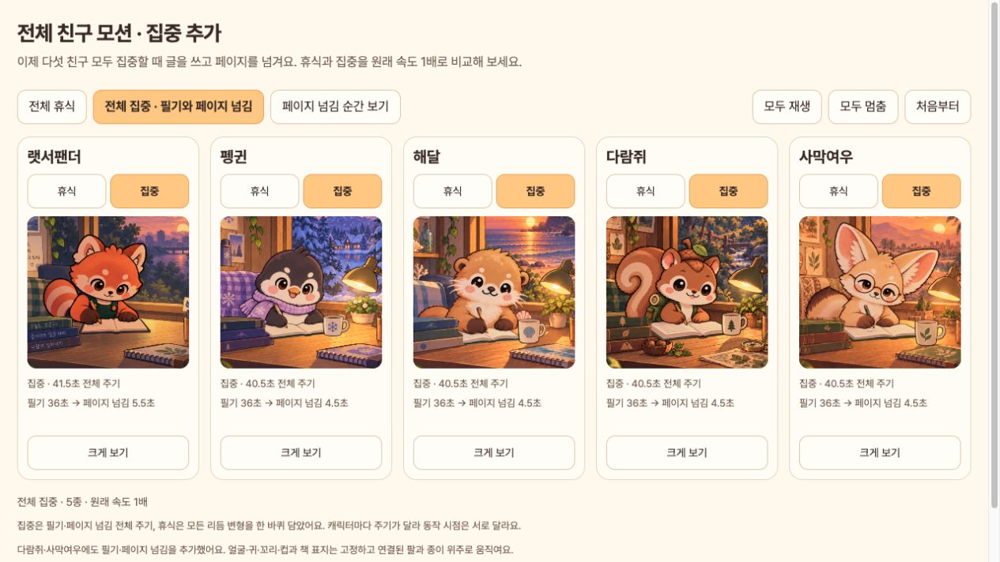

# 전체 캐릭터 모션 V10

다람쥐·사막여우의 집중 정지 장면을 연결된 필기·페이지 넘김 원화로 교체했습니다. 다섯 친구의 집중·휴식 **10개 모드 모두 애니메이션**입니다. [갤러리 열기](index.html). 집중을 기본으로 1배속 재생하며, 전체 휴식 전환·일시정지·확대·페이지 넘김 구간 바로 보기를 지원합니다.

| 친구 | 집중 전체 주기 | 휴식 전체 주기 | 집중 프레임 | 휴식 프레임 |
| --- | --- | --- | --- | --- |
| 랫서팬더 | 41.5초 | 10초 | 498 | 120 |
| 펭귄 | 40.5초 | 22.333초 | 486 | 268 |
| 해달 | 40.5초 | 38초 | 486 | 456 |
| 다람쥐 | 40.5초 | 57초 | 486 | 684 |
| 사막여우 | 40.5초 | 57초 | 486 | 684 |

새 두 친구의 집중은 필기 36초 → 페이지 넘김 4.5초입니다. 팔·연필과 페이지가 움직이며 얼굴·귀·꼬리·찻잔·책 표지를 고정합니다. [새 원화·프롬프트·적용 상세](../squirrel-fennec-study-v1/README.md).

휴식은 이전 통합본과 같습니다. 펭귄은 사용자가 승인한 7–7.7초 변형 예외와 같은 그림 최대 5초 유지 규칙을 적용하며, 해달은 8/9/10/11초, 다람쥐·사막여우는 18/19/20초의 리듬을 연결합니다. [V9 통합 기록](../all-character-motions-v9/README.md).

## 캡처와 회귀 확인

실제 `FocusFriendApp`의 위젯 장면을 프레임별로 캡처하여 12fps, 490×462, H.264 MP4 10개로 인코딩했습니다. 총 **4,654장**입니다. 앱 원화를 웹에서 따로 재현하지 않았습니다. 위젯 캡처는 원화·합성·재생 시계 검증이며, 기기 GPU의 실시간 성능 녹화는 아닙니다.

- 새 두 집중 영상은 각 486장, 필기와 페이지 넘김 구간이 포함되고 시작·마지막 PNG가 정확히 같습니다.
- 나머지 8개 영상의 **3,682장**은 V9와 디코딩 프레임 SHA256이 동일합니다.
- [캡처 manifest](capture/manifest.json), [영상·회귀 검증 JSON](verification.json), [인코딩·비교 도구](create_evidence.py).
- 브라우저에서 10개 영상 로딩, 1배속 재생, 페이지 넘김 38.5초 이동, 확대 화면을 확인했습니다. [브라우저 기록](browser-verification.json).
- 전체 Flutter 테스트 125개 통과, `flutter analyze` 문제 없음. Android 디버그 APK 빌드·에뮬레이터 설치·실행 및 신규 에셋 포함을 확인했습니다. [상세 검증](../squirrel-fennec-study-v1/README.md#검증).



[페이지 넘김 자세](page-turn-gallery-browser.png) · [휴식 갤러리](rest-gallery-browser.png)

```sh
flutter test tool/capture_all_friend_motions_test.dart \
  --dart-define=ALL_MOTION_OUTPUT=docs/design/all-character-motions-v10/capture \
  --dart-define=ALL_MOTION_FULL_STUDY=true --reporter expanded
python3 docs/design/all-character-motions-v10/create_evidence.py
```

PNG 연속 프레임은 영상을 재생성할 때 캡처 도구로 복원할 수 있습니다. 저장소에는 MP4·대표 앱 화면·manifest·검증 JSON을 보관합니다.
