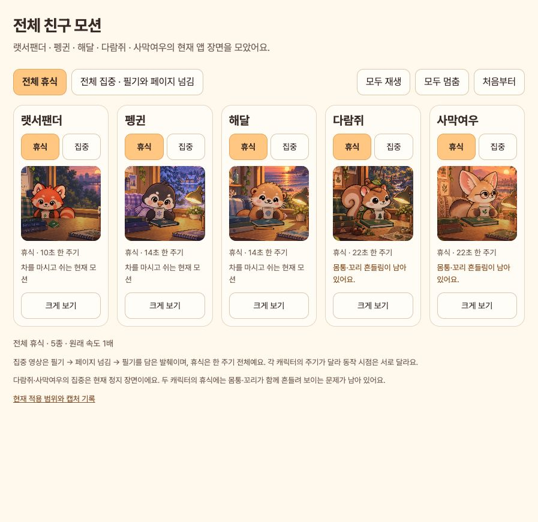
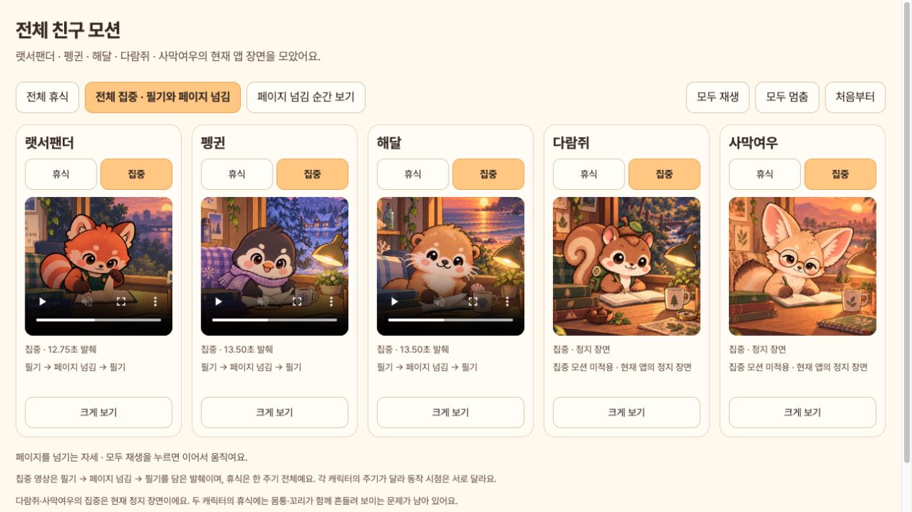

# 전체 캐릭터의 현재 앱 모션

[모션 모아보기](http://127.0.0.1:8127/docs/design/all-character-motions-v8/)에서 다섯 캐릭터를 함께 재생하거나 각 캐릭터의 집중/휴식을 전환하고 크게 볼 수 있습니다. 모두 1배 속도입니다.

| 캐릭터 | 집중 | 휴식 |
| --- | --- | --- |
| 랫서팬더 | 필기·페이지 넘김 | 차 마시기, 10초 한 주기 |
| 펭귄 | 필기·페이지 넘김 | 차 마시기, 14초 한 주기 |
| 해달 | 필기·페이지 넘김 | 차 마시기, 14초 한 주기 |
| 다람쥐 | 현재 정지 장면 | 차 마시기, 22초 한 주기. 몸통·꼬리 흔들림 남음 |
| 사막여우 | 현재 정지 장면 | 차 마시기, 22초 한 주기. 몸통·꼬리 흔들림 남음 |

집중 영상은 실제 앱의 32.4초부터 필기 → 페이지 넘김 → 다음 필기까지 발췌했습니다. 랫서팬더 영상은 12.75초, 펭귄·해달은 13.5초입니다. 집중 영상의 전체 세션을 배속하거나 압축하지 않았습니다. 휴식은 각 캐릭터의 한 주기 전체입니다. 전체 주기 길이가 서로 다르므로 동작 시점은 일치하지 않습니다.

다람쥐·사막여우의 집중 장면을 움직이는 것처럼 꾸미지 않았습니다. 실제 현재 앱이 쓰는 정지 이미지를 표시합니다. 휴식의 알려진 전신 흔들림도 남아 있는 그대로 표시하며 수정 완료라고 설명하지 않습니다.

## 사용 방법

- `전체 휴식` / `전체 집중`으로 전체 장면 전환.
- 카드별 `휴식` / `집중`으로 서로 다른 상태 비교.
- `모두 재생`, `모두 멈춤`, `처음부터`로 전체 제어.
- 집중에서 `페이지 넘김 순간 보기`를 누르면 세 동작 캐릭터의 페이지 넘기는 자세를 정지해 비교.
- `크게 보기`로 해당 캐릭터만 확대. 닫으면 앞서 재생 중이던 카드가 이어서 재생.
- OS의 동작 줄이기를 감지하면 처음에는 자동 재생하지 않음. 재생 버튼으로 볼 수 있음.

## 현재 앱에서 새로 캡처

현재 `FocusFriendApp`과 현재 원화·시각 시계를 사용한 위젯 캡처입니다. 한국어, 저녁 18시, 390×844 논리 화면, 실행 중인 집중/휴식 세션으로 10개 장면을 새로 기록했습니다. 사용자 기록 대신 메모리의 세션을 사용했습니다. 실기기 GPU 동작 녹화는 아닙니다.

캡처 도구는 `tool/capture_all_friend_motions_test.dart`입니다. 랫서팬더·다람쥐·사막여우는 12fps, 그림 혼합을 사용하는 펭귄·해달은 현재 시각 시계에 맞춰 30fps로 캡처했습니다. 출력 영상은 490×462입니다.

[캡처 검사](capture.log) 통과, 새 도구 [정적 분석](analyze.log) 이상 없음. 실제 시각 시계에서 필기와 페이지 넘김이 모두 나오는지, 휴식 자세가 바뀌는지 검사했습니다. 이 검사는 모든 모션이 자연스럽다는 판정은 아닙니다.

[전체 캡처 기록](capture/manifest.json) · [영상 프레임·길이 검사](video-verification.json) · [브라우저 제어 확인](browser-verification.json)

## 화면

