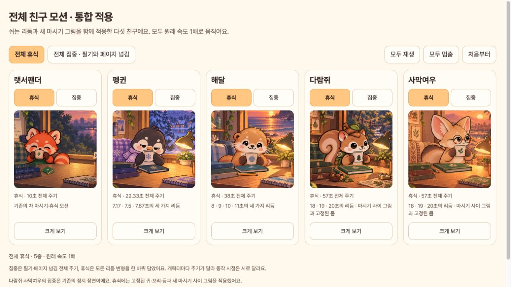
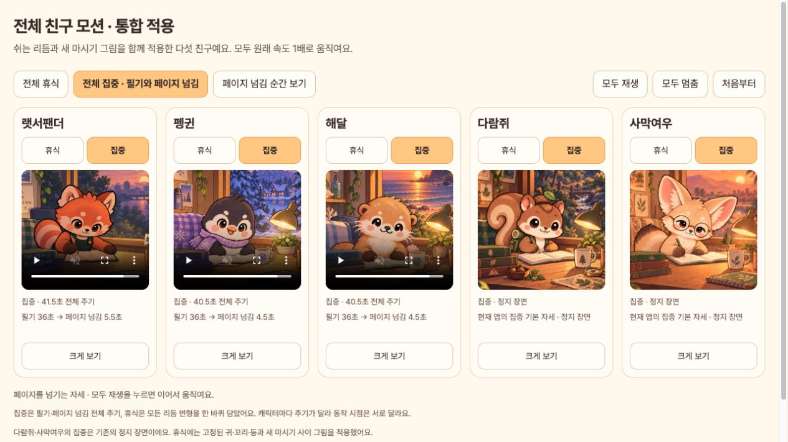

# 전체 캐릭터 모션 · 통합 적용

[모아보기 열기](http://127.0.0.1:8127/docs/design/all-character-motions-v9/)

`feat/rest-rhythm-variants`의 `1a826a5`와 `feat/tea-sip-inbetweens`의 `e7ed48c`를 현재 앱 브랜치 `fix/desk-friend-rest-motion`에 합쳤습니다. 휴식 리듬과 새 마시기 원화가 같은 앱에서 함께 동작합니다. 이전 두 작업의 개별 검증 자료는 각각의 브랜치 당시 결과로 보존했습니다.

다람쥐·사막여우의 고정 동작 안에 A(셀3)·B(셀27)를 왕복으로 각각 2틱씩 넣었습니다. 늘어난 총 8틱을 동작 앞뒤의 쉬는 구간에서 4틱씩 줄여, 변형 길이 18·19·20초와 전체 57초 주기를 유지했습니다. 귀·꼬리·등·모자·가방의 셀0 고정은 마시는 동안에도 적용됩니다.

## 전체 장면

| 친구 | 집중 | 휴식 전체 주기 | 휴식 변형 |
|---|---|---|---|
| 랫서팬더 | 필기·페이지 넘김 41.5초 | 10초 | 기존 모션 |
| 펭귄 | 필기·페이지 넘김 40.5초 | 22.33초 | 7.17·7.50·7.67초 |
| 해달 | 필기·페이지 넘김 40.5초 | 38초 | 8·9·10·11초 |
| 다람쥐 | 기존 정지 장면 | 57초 | 18·19·20초 + 새 마시기 원화 |
| 사막여우 | 기존 정지 장면 | 57초 | 18·19·20초 + 새 마시기 원화 |

모아보기의 **전체 휴식 / 전체 집중**으로 전환하고, 카드의 **크게 보기**로 확대할 수 있습니다. 집중의 **페이지 넘김 순간 보기**는 세 움직이는 캐릭터를 36.75초에서 정지합니다. 모두 재생을 누르면 그 위치에서 이어집니다. 모든 영상은 12fps, 1배속이며 시간 압축을 하지 않았습니다. 동작 줄이기 설정에서는 자동 재생을 시작하지 않습니다.

다람쥐·사막여우의 집중은 이번 두 작업에서 새로 만든 애니메이션이 아니며, 앱의 현재 정지 장면을 그대로 표시합니다.

## 통합 검증

- `flutter test`: **117개 통과**. [로그](flutter-test.log)
- `flutter analyze`: **No issues found**. [로그](flutter-analyze.log)
- 실제 `FocusFriendApp` 캡처 검사: **1개 통과**, 10개 장면 **3,684프레임**. [로그](capture.log), [셀·틱·변형 기록](capture/manifest.json)
- 영상 8개의 프레임 수·12fps·전체 길이를 ffprobe로 검사했습니다. 집중 정지 장면 2개는 PNG입니다.
- 변형별 A/B 경로, 컵 높이, 동일한 동작 시퀀스, 연결 경계, 60틱 이하 유지, 일시정지·백그라운드·동작 줄이기와 고정된 몸·소품을 검사했습니다.
- 동일한 자세와 글씨 진행 상태가 이전 캡처에 있는 **3,339프레임이 PNG SHA-256으로 정확히 일치**합니다. 랫서팬더의 이번 전체 집중 주기 중 이전 발췌에 없는 345프레임은 이 비교에서 제외했습니다. 모든 휴식 프레임은 이전 기준/새 원화 결과와 정확히 일치합니다.
- 브라우저에서 휴식 영상 5개의 정상 로드, 1배속 재생, 집중 전환, 페이지 넘김 시점 이동, 확대·닫기를 확인했습니다. [브라우저 검증](browser-verification.json)

| 친구 | 최대 동일 그림 유지 (경계 포함) | 한 컷 최대 변화 RGB차이>0 | RGB차이>15 |
|---|---:|---:|---:|
| 랫서팬더 | 32틱 | 48,101 | 21,210 |
| 펭귄 | 60틱 | 43,122 | 13,905 |
| 해달 | 58틱 | 48,850 | 19,117 |
| 다람쥐 | 56틱 | 25,445 | 12,307 |
| 사막여우 | 53틱 | 41,749 | 19,439 |

12fps에서 60틱은 5초입니다. 다람쥐·사막여우의 한 컷 최대 변화는 두 계산 모두 같은 조건의 랫서팬더보다 작습니다. 기존 요청의 약21,600을 미세한 차이까지 세는 RGB차이>0의 절대 상한으로 적용하면 두 친구는 초과합니다. 이 측정 정의의 제한은 [원화 검수표](../tea-sip-inbetweens-v1/README.md)와 같습니다. 경계·선 굵기·컵 높이 원화는 이전 검수 후 변경하지 않았습니다.

[전체 수치](verification.json) · [검증·영상 생성 스크립트](create_evidence.py)

## Android 적용

통합 소스로 Android arm64 디버그 APK를 빌드하고, `emulator-5554`의 `dev.jaewook.deskmate`를 `adb install -r`로 업데이트했습니다. 앱 데이터 삭제나 물리 기기 업데이트는 수행하지 않았습니다. 새 두 원화가 APK에 원본과 동일한 SHA-256으로 들어 있음을 검사했습니다. [빌드](android-build.log), [설치 버전](android-installed-version.log), [APK 원화 검증](android-apk-verification.json)

처음 실행할 때 에뮬레이터 시스템 UI가 응답하지 않아 실행 대기가 timeout 되었으나, 테스트 에뮬레이터 재부팅 후 앱의 포그라운드·창 포커스가 정상이고 시스템 UI ANR 및 앱의 fatal/unhandled 오류가 없음을 확인했습니다. [최종 실행 상태](android-runtime-verification.json)

이 모아보기 영상은 한국어·저녁 시간·고정 세션의 실제 Flutter 위젯 캡처입니다. 사용자 기록 대신 메모리 저장소를 사용했고, 실기기 GPU 녹화는 아닙니다.

## 재현

```sh
flutter test tool/capture_all_friend_motions_test.dart --dart-define=ALL_MOTION_OUTPUT=docs/design/all-character-motions-v9/capture --dart-define=ALL_MOTION_FULL_STUDY=true
python3 docs/design/all-character-motions-v9/create_evidence.py /tmp/deskmate-motion-37cf920-baseline /tmp/deskmate-motion-tea-sip-after
```

검증·영상 생성 후 용량이 큰 중간 `capture/frames/`는 제거하고 영상·메타데이터·포스터·앱 화면을 보관합니다. 재현할 때 위 캡처 명령으로 프레임을 다시 생성합니다.




