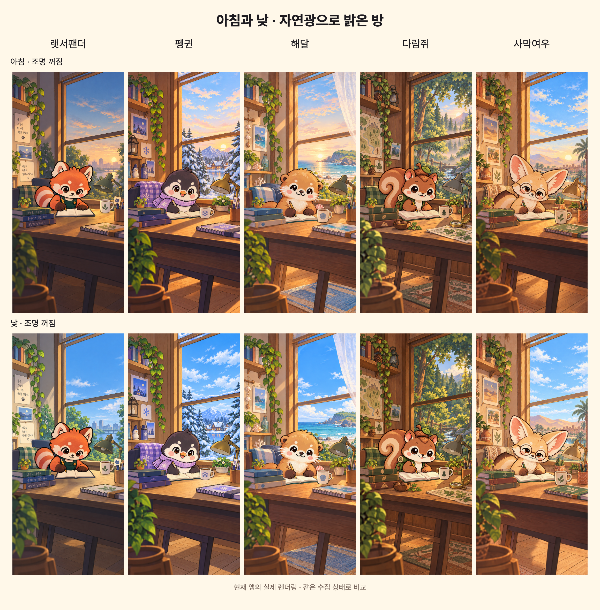
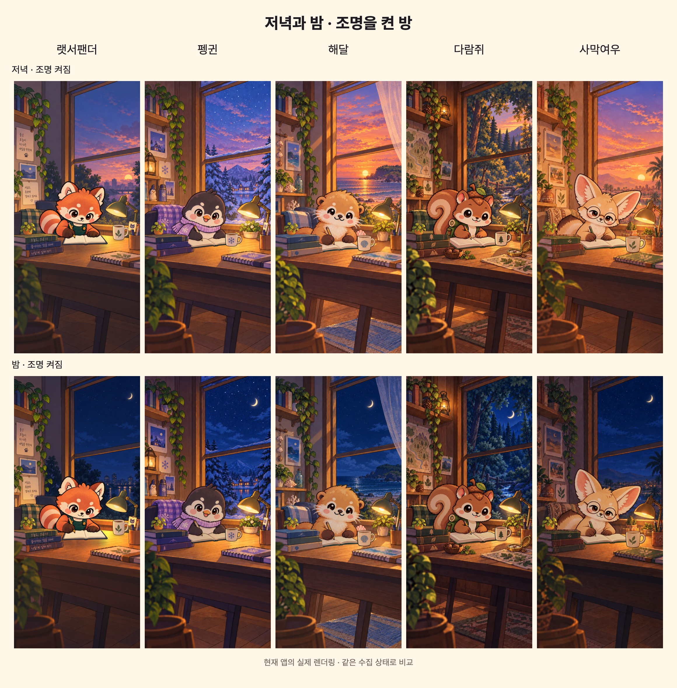

# 아침·낮 조명 꺼짐

2026-11-06. 낮에도 켜져 보이던 전구와 선반 랜턴을 시간대에 맞췄습니다.

- 아침·낮(현지 시각 05:30–17:29): 실내 조명 꺼짐.
- 저녁·밤(17:30–다음 날 05:29): 기존 따뜻한 조명 켜짐.
- 랫서팬더: 같은 위치·크기의 투명 `reward-lamp-unlit.png`를 사용하며 시간대 경계에서 2초 동안 전환합니다.
- 펭귄: 아침의 책상 조명과 선반 랜턴을 수정했습니다. 낮 이미지는 원래 꺼져 있어 유지했습니다.
- 해달: 아침·낮 책상 조명을 수정했습니다.
- 다람쥐: 아침·낮 책상 조명과 선반 랜턴을 수정했습니다.
- 사막여우: 아침·낮 조명이 이미 꺼져 있어 기존 이미지를 유지했습니다.

모은 소품의 개수·해금 조건·기록에는 변화가 없습니다. 조명 상태는 방의 기존 시간대 전환에 따라 바뀝니다. 실내 불빛만 끄며 자연광과 햇빛은 유지합니다.

## 이미지와 출처

모든 편집은 내장 ImageGen 도구를 사용했습니다. 최종 PNG는 아래 프로젝트 경로에 저장했고, 정확한 프롬프트는 각 PNG 옆의 `.prompt.txt`에 있습니다.

- `assets/images/immersive/reward-lamp-unlit.png`
- `assets/images/friends/ambience/penguin/morning-unlit.png`
- `assets/images/friends/ambience/otter/morning-unlit.png`
- `assets/images/friends/ambience/otter/day-unlit.png`
- `assets/images/friends/motion/squirrel/rooms/morning-unlit.png`
- `assets/images/friends/motion/squirrel/rooms/day-unlit.png`

원본 이미지는 보존했습니다. 대체된 낮 배경은 새 버전만 앱 번들에 포함합니다. 최종 배경은 모두 기존 853×1844를 유지하며, 랫서팬더 조명은 원본과 같은 1045×1505 및 투명도를 유지합니다. 생성 편집 특성상 광원 외부에도 미세한 색·질감 차이는 있지만 실제 장면에서 책상·캐릭터 배치의 정합성을 확인했습니다.

## 검증과 캡처

- 정적 분석: 문제 없음.
- `flutter test --no-pub`: 전체 227개 통과.
- 시간대 경계, 실제 이미지 선택, 런타임 이미지 규격, 전환 후 이전 이미지 제거, 수집 상태와 저장 데이터 보존을 검증합니다.
- `flutter test --no-pub tool/capture_daylight_lamps_test.dart tool/capture_collected_friends_test.dart`: 실제 Flutter 렌더 캡처 2개 테스트 통과.
- 아래 캡처는 같은 소품 획득 상태로 비교한 실제 렌더링입니다.

