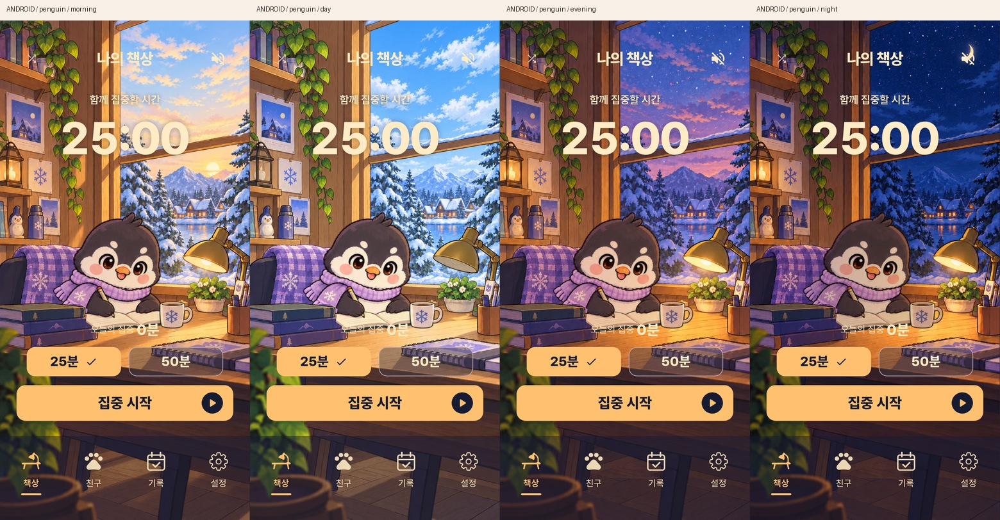
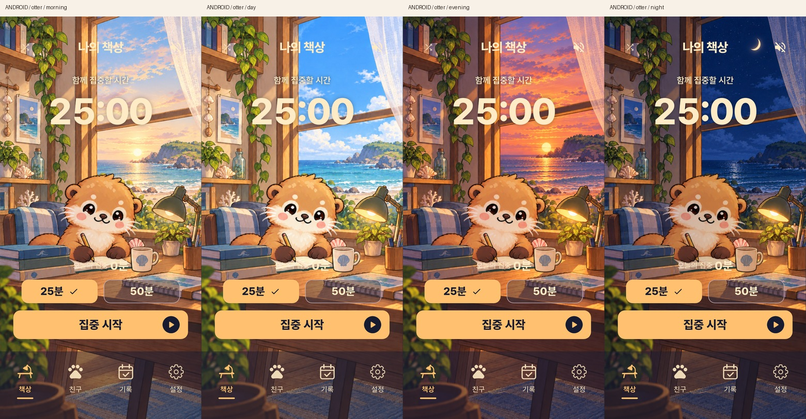
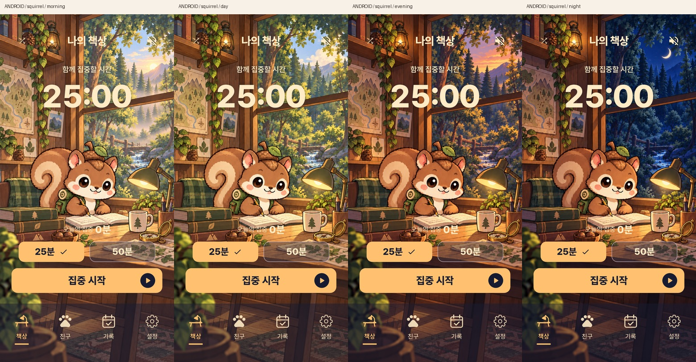
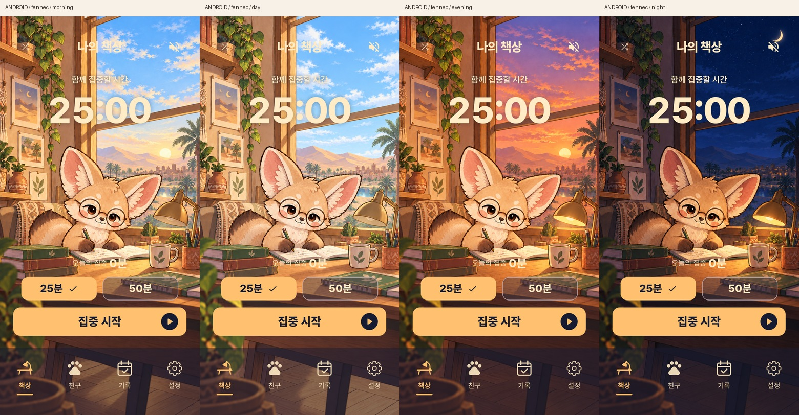

# 네 친구의 아침·낮·저녁·밤 적용

2026-10-15. 승인한 [4단계 시안](../friend-time-of-day-concepts-v2/README.md)을 기존 Flutter 앱에 적용했습니다. 펭귄·해달·다람쥐·사막여우 모두 휴대폰 현지 시간에 따라 자동 전환됩니다.

| 아침 | 낮 | 저녁 | 밤 |
| --- | --- | --- | --- |
| 05:30–07:59 | 08:00–17:29 | 17:30–19:59 | 20:00–다음 날 05:29 |

시간대는 기존 랫서팬더와 같은 `RoomAmbience`를 사용합니다. 배경과 앞쪽 소품이 2초 동안 함께 바뀌며, 기기의 동작 줄이기를 켜면 즉시 바뀝니다. 대기 상태에서도 매분 확인하고 앱 복귀 시 갱신합니다.

## 실제 Android 적용 화면

각 이미지의 왼쪽부터 아침·낮·저녁·밤입니다. 모두 별도 검증용 Android 앱의 실제 Flutter 화면입니다.

- [펭귄](penguin-native-periods.jpg)
- [해달](otter-native-periods.jpg)
- [다람쥐](squirrel-native-periods.jpg)
- [사막여우](fennec-native-periods.jpg)






## 동작과 자산

펭귄·해달은 기존 필기·페이지 넘김·찻잔 휴식 원화를 유지했습니다. 시간대별 빈 방 위에 같은 캐릭터를 겹치고, 방 전환 중에도 캐릭터 재생 위치를 보존합니다. 캐릭터·책·컵의 빛도 배경 전환에 맞춰 부드럽게 바뀝니다. 홈 대기·집중·휴식에서 같은 방 구도를 사용합니다. 다람쥐·사막여우는 후속 작업으로 [시간대별 창가 찻잔 휴식](../fennec-squirrel-window-tea-v1/README.md)을 지원하며, 두 친구의 대기·집중 포즈는 정지 그림입니다.

실행용 PNG 16장은 `assets/images/friends/ambience/{penguin,otter,squirrel,fennec}/{morning,day,evening,night}.png`에 있으며 모두 **853×1844px**입니다. 시안 보드를 잘라 쓰지 않고 원본 장면의 배치를 유지한 개별 이미지로 제작했습니다. 새 시간대 12장은 **built-in ImageGen**으로 생성했고 정확한 요청문은 이 폴더의 `*-morning.prompt.txt`, `*-day.prompt.txt`, `*-evening.prompt.txt`, `*-night.prompt.txt`에 있습니다. 생성 원본·참고·검수 기록은 같은 이름의 JSON과 [asset-manifest.json](asset-manifest.json)에 있습니다.

기존 펭귄 저녁 방, 해달 낮 방, 다람쥐 낮 장면, 사막여우 저녁 장면은 원본을 그대로 복사했습니다. 기존 파일과 앞선 시안은 보존했습니다. 밝은 낮 배경에서 하단 메뉴가 흐려지는 문제는 반투명 바탕과 밝은 아이콘·글자로 보완했습니다.

## 검증 및 설치

- 전체 Flutter 테스트와 화면 캡처 **92개 통과**: [tests.log](tests.log).
- 정적 분석 이상 없음: [analyze.log](analyze.log).
- 별도 Android 검증 패키지에서 16개 시간대 전환 및 저장 상태 불변 확인: [native-test.log](native-test.log), [native-verification.json](native-verification.json).
- 시안과 실제 렌더를 함께 비교: [검증 보고서](design-qa.md).
- Android debug APK 빌드 후 `작은 집중방 Dev`에 업데이트 설치했습니다. [APK](../../../deliverables/friend-time-of-day/Focus-Friend-Dev.apk).
- 업데이트와 재실행 전후 저장 JSON의 SHA-256 및 revision 30이 동일합니다. 기록·친구 선택·진행 세션·설정을 보존했습니다. [데이터 보존 결과](data-preservation.json).

재현 명령:

```sh
flutter analyze --no-pub
flutter test --no-pub test tool/capture_friend_ambience_test.dart
python3 tool/verify_friend_ambience.py
```

마지막 명령은 별도 임시 소스 사본과 `.verification` 앱을 사용하며, 일반 앱 데이터베이스를 열거나 변경하지 않습니다. 생성된 일반 앱 APK 설치는 별도로 수행했습니다.
