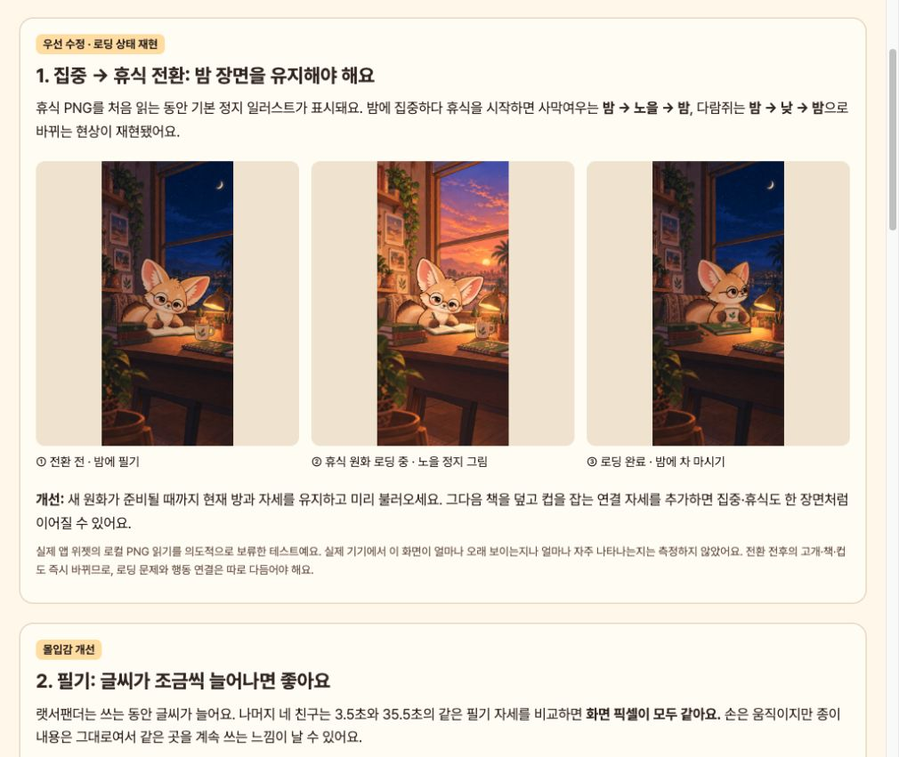
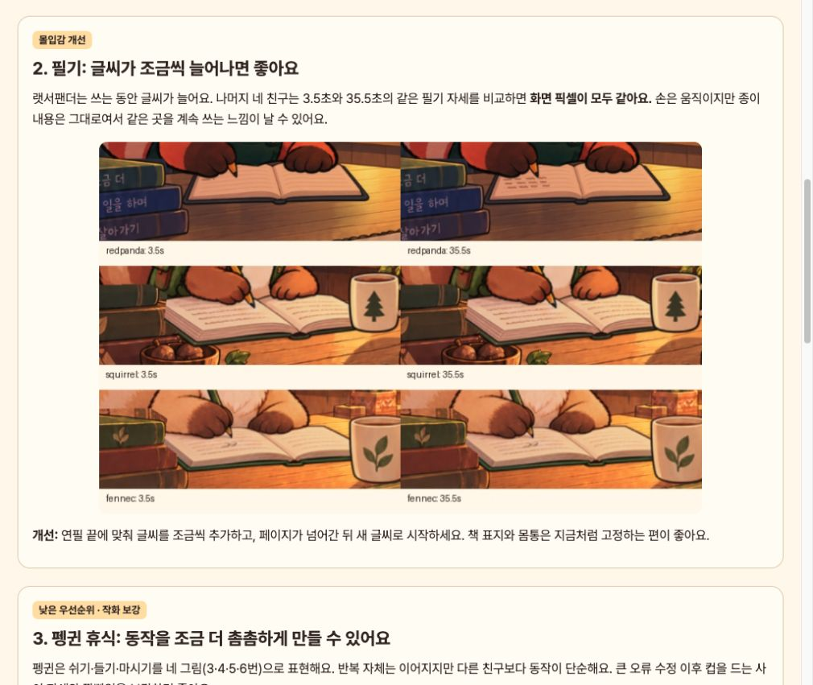
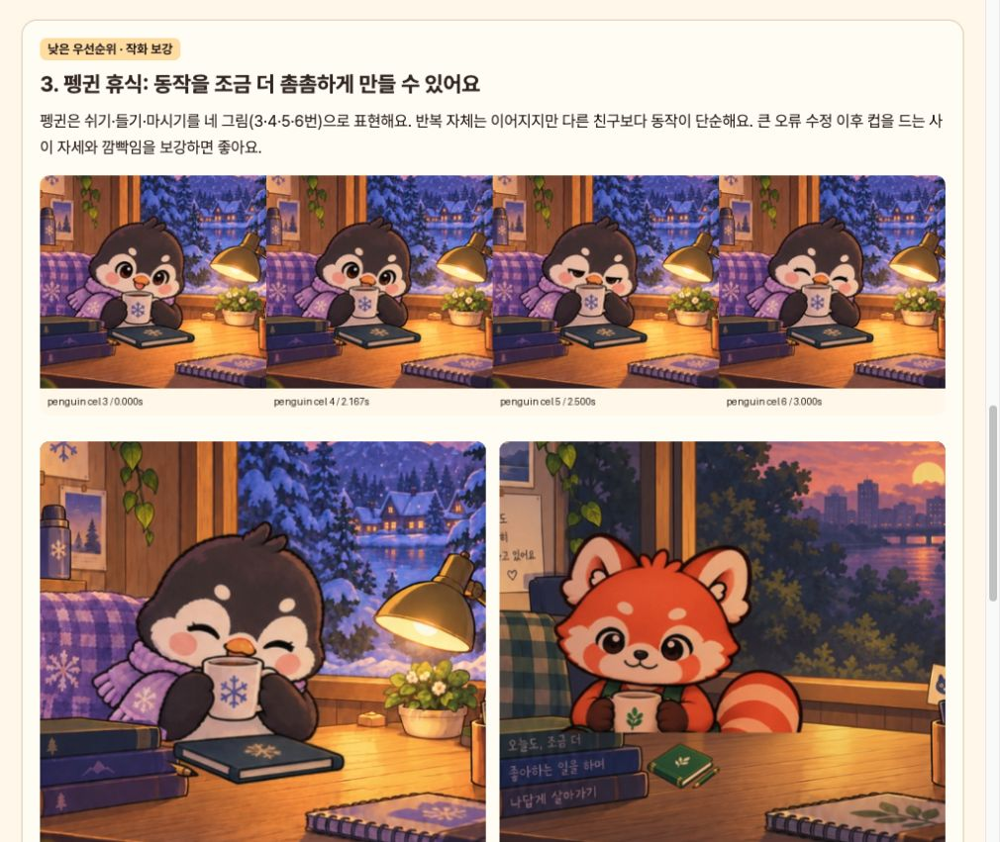
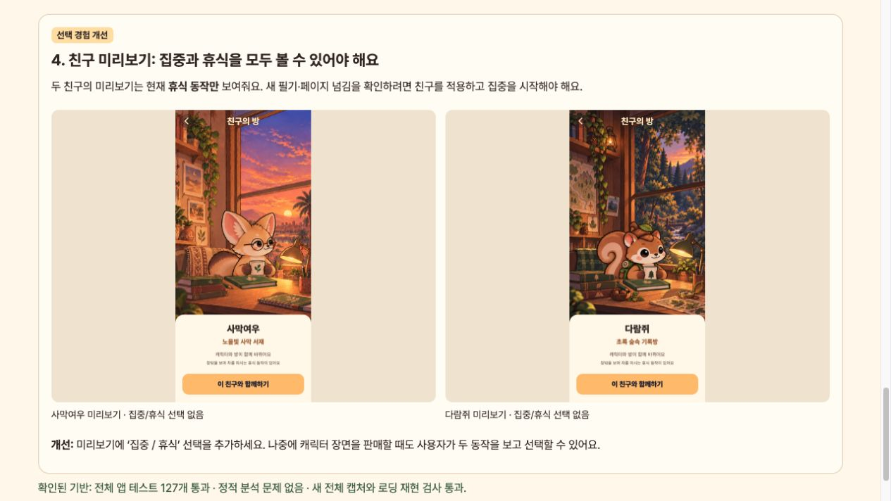

# 현재 캐릭터 모션 추가 개선 검토

2026-10-24 · 앱 코드 `3fa176e` 기준. [검토 화면](index.html) · [새 전체 모션 갤러리](motions.html).

이전 검토 뒤 페이지 넘김 순서(`375dfba`), 펭귄·해달의 책상 연필 유지(`4b1fa12`), 휴식 속도(`e5e67fc`) 수정이 들어왔습니다. 예전 V10 영상을 현재 버전으로 간주하지 않고 실제 `FocusFriendApp`에서 10개 모드를 새로 캡처했습니다. 이번 작업은 검토 도구·캡처·기록만 추가하며 앱 동작과 원화를 바꾸지 않습니다.

## 검토 단계와 우선순위

| 단계 | 상태·우선순위 | 관찰 | 권장 개선 |
| --- | --- | --- | --- |
| 1. 집중→휴식 전환 | 재현된 결함 · 우선 수정 | 다람쥐·사막여우의 휴식 PNG가 준비되기 전 기본 `sceneAsset`이 표시됩니다. 밤 상태에서 사막여우는 노을, 다람쥐는 낮 장면을 잠시 표시하고 밤 휴식 방으로 돌아옵니다. 준비 전후에 고개 방향·열린 책/닫힌 책·컵 위치도 바로 교체됩니다. | 원화를 미리 읽고 준비 전에는 현재 방·자세 유지. 이후 책 덮기→컵 잡기의 연결 자세를 별도 보강. |
| 2. 필기 글씨 | 몰입감 개선 · 중간 우선순위 | 같은 필기 자세인 3.5초와 35.5초를 비교하면 랫서팬더는 잉크 350픽셀이 변하지만 나머지 네 친구는 490×462 장면 전체가 픽셀 단위로 같습니다. 글씨가 누적되지 않습니다. | 연필 끝과 맞는 글씨 진행을 별도 레이어로 그리고 페이지 넘김 뒤 초기화. |
| 3. 펭귄 휴식 | 작화 제안 · 낮은 우선순위 | 현재 휴식 전체에서 쓰는 그림은 3·4·5·6번 네 개입니다. 재생은 이어지지만 컵 들기·표정 변화가 다른 친구보다 단순합니다. 그림 수 자체를 품질 결함으로 판정한 것은 아닙니다. | 컵을 드는 사이 자세 1–2장과 깜빡임을 추가해 변화를 촘촘하게 표현. |
| 4. 친구 미리보기 | 선택 경험 개선 · 중간 우선순위 | 다람쥐·사막여우 미리보기의 `resting=true`, `studying=false`. 집중/휴식 선택이 없고 안내도 휴식 동작만 소개합니다. 새 집중 모션을 보려면 적용 후 세션을 시작해야 합니다. | 미리보기에 ‘집중 / 휴식’을 추가해 두 모드를 적용 전에 확인. 캐릭터 판매를 준비할 때도 유용. |

### 1. 전환 시 장면이 바뀌는 재현



실제 `DeskIllustration`과 `FriendMotionScene` 위젯을 사용했습니다. `HeldRestBundle`로 **휴식 PNG 읽기만 의도적으로 보류**하고, 움직임을 꺼 전환 상태를 분리했습니다. 따라서 이 검사는 로딩 중 표시되는 그림의 결함을 입증하지만 실제 기기에서 보이는 시간·발생 빈도나 GPU 프레임 드롭을 측정하지 않습니다.

[재현 도구](../../../tool/capture_motion_quality_test.dart) · [값 기록](fixtures/verification.json) · [다람쥐 전환·미리보기 확인](fixtures/squirrel-review-contact.jpg).

원인: [friend_motion_scene.dart](../../../lib/friend_motion_scene.dart)의 준비되지 않은 분기에서 현재 시간대와 무관한 `friend.sceneAsset`을 반환합니다. 원화 준비 후에는 요청한 밤 방으로 다시 그립니다. 고개·책·컵의 행동 연결은 이 로딩 문제와 별개로 남습니다.

### 2. 필기 결과의 누적 여부



| 친구 | 3.5초→35.5초 변화 픽셀 | 결과 |
| --- | --- | --- |
| 랫서팬더 | 350 | 글씨 증가 |
| 펭귄 | 0 | 동일 장면 |
| 해달 | 0 | 동일 장면 |
| 다람쥐 | 0 | 동일 장면 |
| 사막여우 | 0 | 동일 장면 |

둘 다 필기 1번 셀인 프레임 42·426을 새 캡처에서 비교했습니다. [수치](verification.json), [원본 비교 이미지](writing-progress-comparison.jpg). 동작 중 손이 움직이지 않는다는 의미가 아니라 같은 자세로 돌아왔을 때 종이에 남은 결과가 없다는 뜻입니다.

### 3. 펭귄의 휴식 동작 밀도



[실제 앱의 네 자세](penguin-lift.jpg), [펭귄 1배속 영상](capture/penguin-rest.mp4). 사용자가 승인한 펭귄 변형 길이 예외와 최대 5초 유지 규칙은 현재 테스트에서 통과합니다. 이 항목은 큰 끊김 오류를 단정하는 대신 상품용 작화의 보강 후보로 둡니다.

### 4. 친구 미리보기



실제 `FriendPreview`를 앱 테마·글꼴로 열고 에셋이 준비된 뒤 캡처했습니다. [사막여우 원본](fixtures/fennec-04-friend-preview.png), [다람쥐 원본](fixtures/squirrel-04-friend-preview.png). `FriendArtwork`가 창가 친구에게 휴식만 지정하므로, 반복을 기다려도 집중 모드로 전환되지 않습니다. 재생 시간대도 현재는 저녁으로 고정됩니다.

## 현재 모션 캡처·검증

| 친구 | 집중 전체 주기 | 휴식 변형 전체 주기 |
| --- | --- | --- |
| 랫서팬더 | 41.5초 / 498장 | 10초 / 120장 |
| 펭귄 | 40.5초 / 486장 | 22.333초 / 268장 |
| 해달 | 40.5초 / 486장 | 30초 / 360장 |
| 다람쥐 | 40.5초 / 486장 | 30.5초 / 366장 |
| 사막여우 | 40.5초 / 486장 | 30.5초 / 366장 |

총 **3,922프레임, MP4 10개**, 모두 12fps·1배속. 휴식은 현재의 모든 리듬 변형을 포함합니다. [manifest](capture/manifest.json), [인코딩·수치 검증](verification.json), [생성 도구](create_evidence.py), [브라우저 검증](browser-verification.json).

```sh
flutter test tool/capture_all_friend_motions_test.dart \
  --dart-define=ALL_MOTION_OUTPUT=docs/design/motion-quality-audit-v2/capture \
  --dart-define=ALL_MOTION_FULL_STUDY=true --reporter expanded
python3 docs/design/motion-quality-audit-v2/create_evidence.py
flutter test tool/capture_motion_quality_test.dart --reporter expanded
flutter test --reporter expanded
flutter analyze
```

- 전체 테스트 **127개 통과**, 정적 분석 **문제 없음**. [테스트 로그](flutter-test.log), [분석 로그](flutter-analyze.log).
- 전체 캡처 1개 검사, 로딩·미리보기 재현 1개 검사 각각 통과. [캡처 로그](capture.log), [재현 로그](fixtures.log).
- 기기의 동작 줄이기, 일시정지·백그라운드 복귀는 기존 자동 검사 범위에서 통과했습니다. TalkBack 실사용이나 전체 접근성 적합성을 검증하지는 않았습니다. 새 모드 버튼을 추가할 때 선택 상태·접근성 이름도 함께 제공해야 합니다.
- 이번 결과는 새로 캡처한 실제 Flutter 위젯 기준입니다. Android GPU 실시간 녹화나 실기기 설치를 수행하지 않았습니다.
- 화면을 저장하고 다시 열어 확인했습니다. 글꼴이 준비되지 않았거나 영상이 버퍼링 중인 초기 캡처는 최종 증거로 사용하지 않았습니다.
- PNG 연속 프레임 캐시는 인코딩·수치 비교를 마친 뒤 지웠습니다. 다시 필요하면 위 캡처 명령으로 생성할 수 있습니다.

먼저 1번의 장면 유지 문제를 고친 다음, 2·4번으로 필기와 선택 경험을 보완하고 3번의 작화를 추가하는 순서가 좋습니다.
