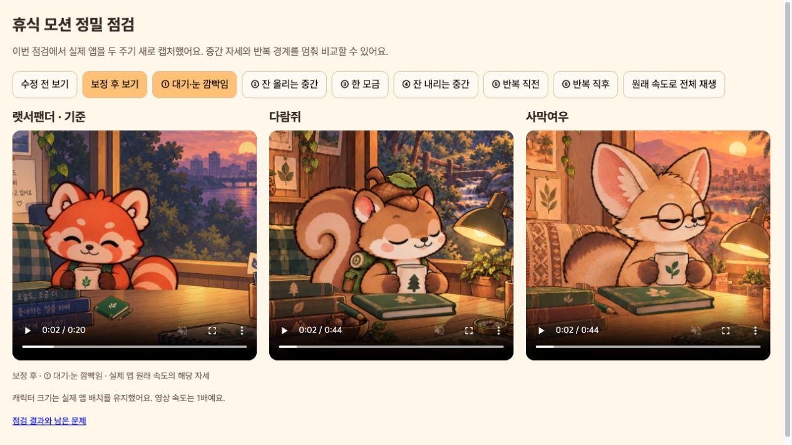
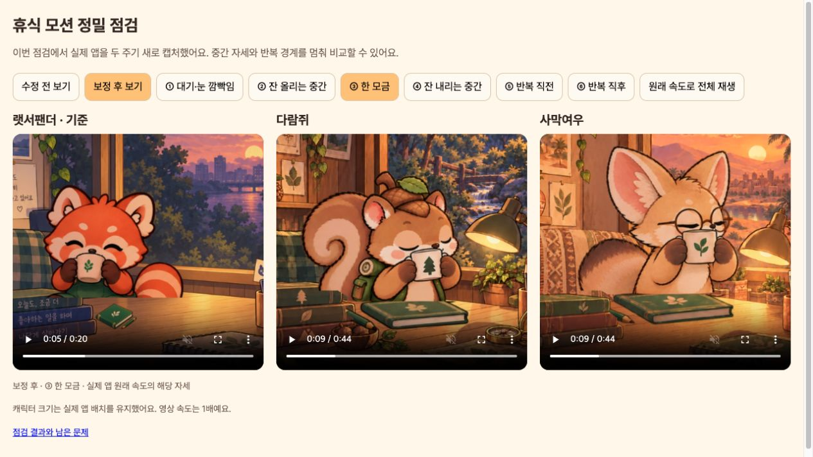
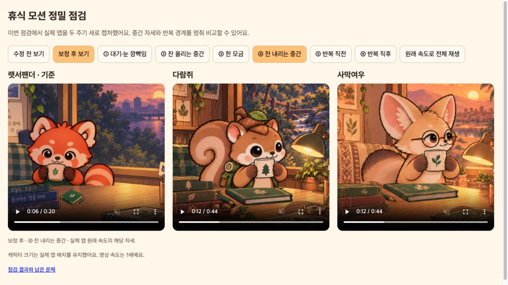
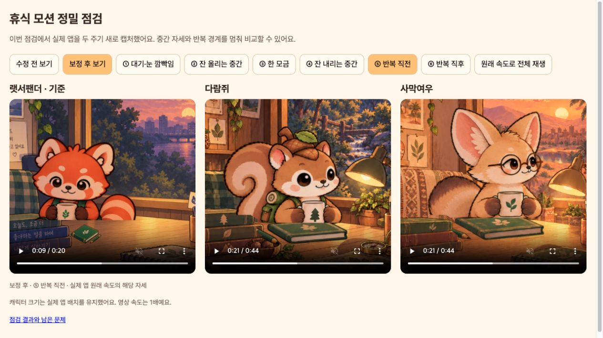
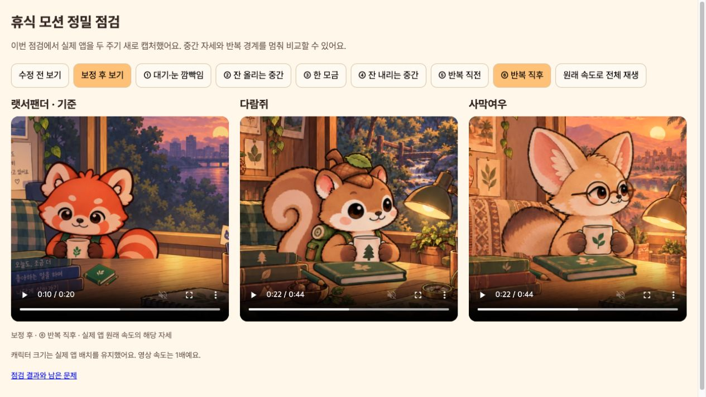

# 휴식 모션 점검: 기능 정상, 작화 연결 보완 필요

이번 점검에서 **현재 Flutter 앱을 새로 캡처**했습니다. 수정 전과 보정 후 각각 랫서팬더 20초(두 주기), 사막여우·다람쥐 44초(두 주기)를 같은 화면·저녁 시간·원래 속도로 기록했습니다.

[움직이는 점검 화면](http://127.0.0.1:8127/docs/design/rest-motion-audit-v3/)에서 수정 전/보정 후 전환, 단계별 정지, 전체 재생이 가능합니다. [사막여우 전후](fennec-before-after.jpg), [다람쥐 전후](squirrel-before-after.jpg)도 보관했습니다.

## 판정

이전 답변에서 모션 적용 완료와 자연스러움 검증을 충분히 구분하지 못했습니다. 기능은 동작하지만 **추가 작화 없이 완전히 자연스럽다고 판정할 수는 없습니다.**

| 단계 | 상태 | 이번 점검의 근거 |
| --- | --- | --- |
| 1. 대기·눈 깜빡임 | 정상, 미세한 윤곽 변화 남음 | 실제 앱 2.96초 정지/재생. 얼굴과 컵이 이중으로 겹치지는 않음. 원화마다 작은 형태 차이는 존재. |
| 2. 컵 올리기 | 보완 필요 | 기존에는 각 원화를 0.333초씩 유지. 컵의 이동 폭이 일정하지 않아 큰 구간이 계단처럼 보임. 특히 사막여우의 초반과 중간이 두드러짐. |
| 3. 한 모금 | 정상, 작은 컵 위치 차이 남음 | 9초 자세에서 손과 몸이 붙어 있고 컵은 하나. 눈을 감는 원화로 바뀔 때 컵의 작은 위치 차이는 남음. |
| 4. 컵 내리기 | 일부 보정, 연결 보강 필요 | 거의 같은 원화/역방향 원화를 제외. 큰 자세 간격 자체는 새 원화가 필요. |
| 5. 반복 직전·직후 | 정상 | 21.92초/22.08초의 전체 앱 화면이 픽셀 단위로 동일. 두 주기 캡처와 [반복 경계 검사](loop-boundary-check.json)로 확인. |
| 6. 일시정지·앱 복귀·동작 줄이기 | 테스트 정상 | 실제 위젯의 시각 시계가 정지/재개되고, 화면 비활성 및 OS 생명주기 백그라운드에서도 자세를 보존함. |

## 확인한 문제와 적용한 보정

1. 원화마다 귀/모자의 외곽 폭으로 크기를 따로 맞춰 전체 몸 크기도 바뀌었습니다. 사막여우는 약 1.4%, 다람쥐는 약 2.1%의 원화별 배율 차이가 있었습니다. **캐릭터별 한 배율로 고정**하고, 눈과 컵이 아닌 귀/모자/이마를 기준으로 그림 전체 위치만 맞췄습니다. 신체 부위를 늘리거나 회전시키지 않습니다.
2. 입 부근의 12·13번 원화는 거의 같은 자세가 반복되거나 컵이 잠깐 역방향으로 움직여 보였습니다. 이 둘을 재생에서 제외하고, 입에 댄 14번 자세에 머무는 시간을 배정했습니다. 내리는 동작도 같은 유효 자세의 역순으로 정리했습니다.
3. 책·연필·방은 고정입니다. 테스트가 모든 원화에서 책 영역의 실제 픽셀을 비교합니다. 컵·팔의 이중 윤곽을 만드는 이미지 혼합이나 메쉬 변형은 사용하지 않습니다.

이 보정으로 원화의 형태 차이가 사라지는 것은 아닙니다. [정렬 측정](registration-check.json)은 다람쥐의 정적 머리 영역 차이가 줄었고 사막여우의 평균 색상 차이는 거의 동일함을 보여 줍니다. 따라서 사막여우의 얼굴·꼬리가 완전히 고정됐다는 주장은 하지 않습니다.

## 남은 문제

현재 올리는 구간은 대체로 초당 약 3개의 다른 그림을 보여 줍니다. 12fps는 시계의 격자이며 새 그림이 초당 12장 있는 것이 아닙니다. 큰 자세 차이를 오랫동안 보여 주는 한, 전체 주기나 화면 갱신 속도만 바꿔서는 자연스러움이 해결되지 않습니다.

특히 사막여우의 `0→4`, `4→5`, `7→8`, `8→9`와 다람쥐의 `6→7`, `11→14` 사이에 얼굴·몸·컵 크기를 유지하는 연결 원화가 더 필요합니다. 같은 얼굴·꼬리·컵 실루엣을 고정한 상태에서 두 자세의 정확한 중간을 그려야 합니다. 눈을 감는 원화에서도 컵과 손 위치를 맞춰야 합니다.

이번에 built-in ImageGen으로 각 캐릭터 12개의 중간 원화 후보도 제작했지만, 일부 얼굴·몸 비율과 컵 이동이 기준 원화에서 달라져 **채택하지 않았습니다.** [후보와 프롬프트 기록](rejected/asset-manifest.json)에 남겼으며 앱에는 포함하지 않았습니다. 부적합한 후보를 넣고 프레임 수만 늘리지 않았습니다.

## 검증과 한계

- 전체 Flutter 테스트 97개 통과.
- 수정 전·후 실제 전체 앱 두 주기 캡처 테스트 각각 통과.
- 정적 분석 이상 없음, Android 디버그 APK 빌드 성공.
- 타이머·저장 구조와 펭귄·해달·랫서팬더 모션 코드는 바꾸지 않았습니다.
- `test/window_tea_test.dart`에서 실제 앱 생명주기 백그라운드/복귀 검사도 추가했습니다.
- 원화 정렬/포장은 `tool/package_window_tea_v3.py`입니다. 그림을 다시 그리지 않고 기존 원화 전체에 같은 크기와 위치 정렬을 적용합니다.
- 화면 캡처와 위젯 테스트 기준 점검이며 실기기 GPU 성능이나 모든 OS 보조기기 동작을 검증한 결과는 아닙니다.

[전체 테스트](tests.log), [회귀 검사](targeted-tests.log), [분석](analyze.log), [빌드](build.log), 수정 전·후 [캡처](after/capture.log), [시각 시계 기록](after/capture-manifest.json)을 보관했습니다.

최종 자산은 `assets/images/friends/motion/{fennec,squirrel}/rest.png`, 정렬 기록은 `art/{fennec,squirrel}-registration.json`입니다. 기준 원화와 제작 프롬프트는 [이전 제작 기록](../window-tea-connected-v2/asset-manifest.json)에 있습니다.

보정본을 에뮬레이터 `emulator-5554`에 업데이트했고, 설치 APK의 원화가 검증한 자산과 동일합니다. [저장 데이터 검사](data-preservation.json)에서 업데이트 전후 JSON이 정확히 같음을 확인했습니다. [최종 판정](verification.json)

## 이번 점검의 단계별 화면

### 1. 대기·눈 깜빡임

정상. 작은 원화 윤곽 차이는 남습니다.

### 2. 잔 올리기

추가 작화 필요. 이 정지 자세 자체보다 이웃 자세로 넘어가는 간격이 문제입니다.

### 3. 한 모금

연결된 손·몸과 하나의 컵이 정상 표시됩니다.

### 4. 잔 내리기

역방향 자세는 제외했으나 큰 자세 간격 보강이 필요합니다.

### 5. 반복 직전

기본 자세로 복귀합니다.

### 6. 반복 직후

직전과 같은 자세로 연결됩니다.

