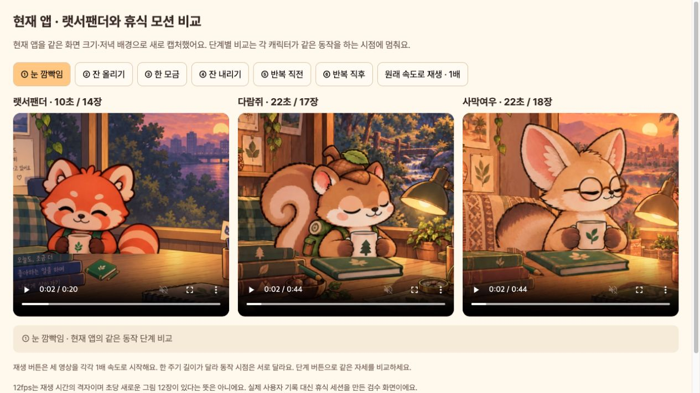
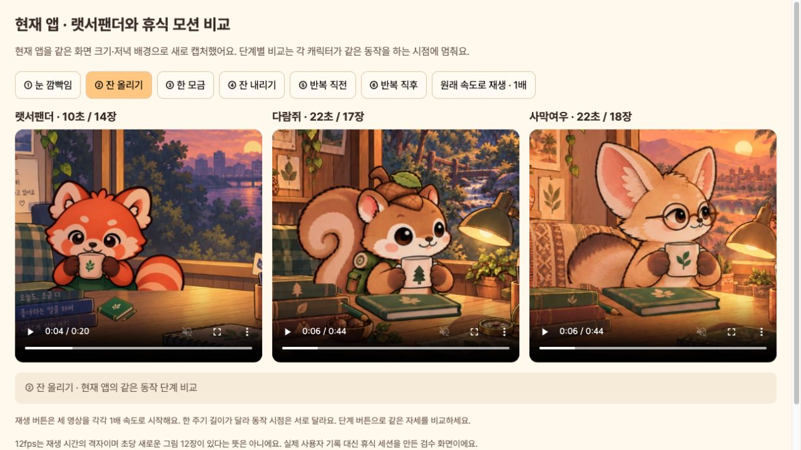
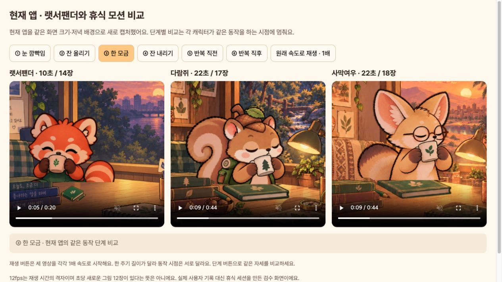
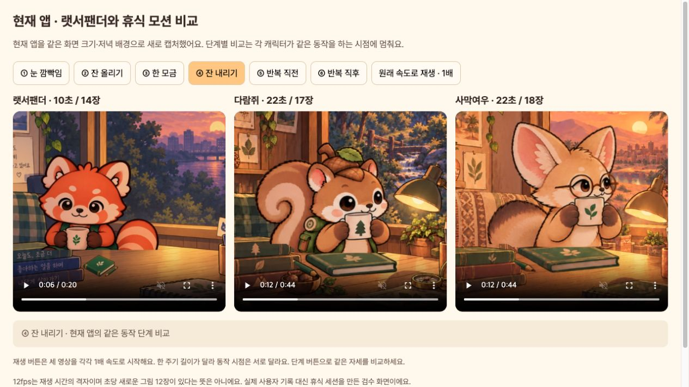
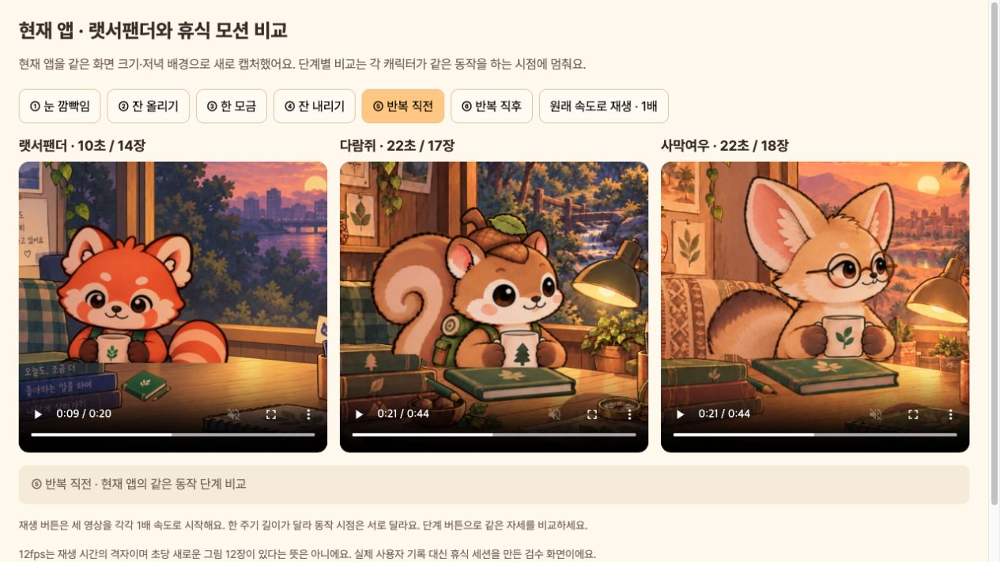
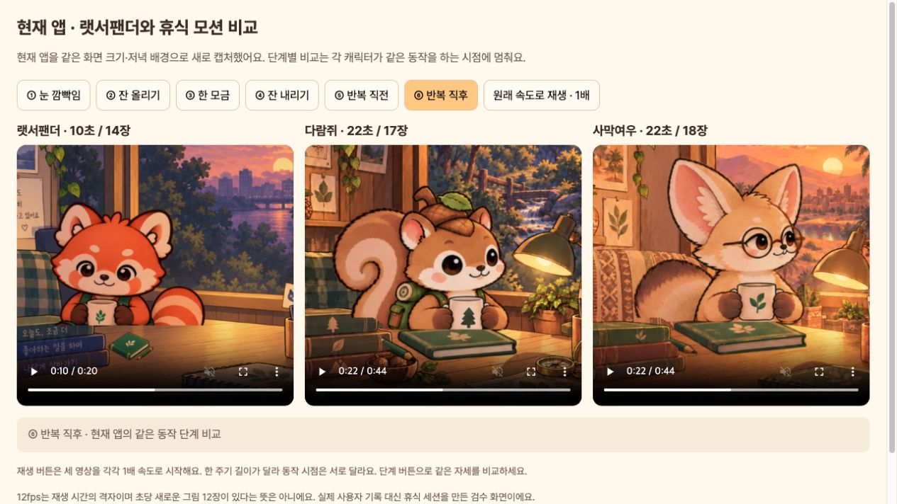

# 현재 앱에서 랫서팬더와 휴식 모션 비교

**원리는 같고 템포는 다릅니다. 다람쥐·사막여우가 랫서팬더와 같은 수준으로 완전히 자연스럽다고 판정하지는 않습니다.**

현재 소스의 실제 `FocusFriendApp`을 390×844 논리 화면, 한국어, 저녁 18시, 실행 중인 휴식 상태로 새로 캡처했습니다. 랫서팬더는 20초, 다람쥐·사막여우는 44초로 각각 두 주기입니다. 기존 영상은 판정 근거로 재사용하지 않았습니다. 사용자 저장 기록 대신 메모리의 휴식 세션을 사용했습니다.

[현재 앱 모션 비교 화면](http://127.0.0.1:8127/docs/design/rest-panda-parity-v5/)에서 세 캐릭터를 1배 속도로 재생하거나 같은 동작 단계에 멈춰 볼 수 있습니다.

## 방식과 템포

| 항목 | 랫서팬더 | 다람쥐 | 사막여우 |
| --- | --- | --- | --- |
| 재생 방식 | 연결된 전체 원화 한 장씩 표시 | 동일 원리 | 동일 원리 |
| 시간 격자 | 12fps | 12fps | 12fps |
| 실제 재생 원화 | 14장 | 17장 | 18장 |
| 한 주기 | 10초 | 22초 | 22초 |
| 잔 올리기 | 약 1.5초, 3.33~4.83초 | 3.5초, 5~8.5초 | 3.5초, 5~8.5초 |
| 한 모금 머물기 | 1초 | 1.5초 | 1.5초 |
| 그림 혼합·팔만 별도 회전 | 없음 | 없음 | 없음 |
| 반복 경계 | 마지막 11번→시작 0번, 작은 차이 있음 | 같은 0번, 캡처 픽셀 동일 | 같은 0번, 캡처 픽셀 동일 |

12fps는 시간의 격자입니다. 매초 새로운 원화 12장을 재생한다는 뜻이 아닙니다. 그림 수가 더 많아도 전체 주기가 더 길고 자세 간격이 고르지 않으면 자동으로 더 부드러워지는 것은 아닙니다.

## 단계별 판정

1. **눈 깜빡임 — 정상.** 세 캐릭터 모두 눈이 닫히고 컵·팔이 연결되어 있습니다. 랫서팬더는 실제 앱에서 더 작게 배치되어 작은 윤곽 변화가 덜 도드라집니다.
2. **잔 올리기 — 동작 정상, 연결 다듬기 여지.** 다람쥐·사막여우는 몸 전체를 따로 흔드는 변형 없이 컵과 팔이 함께 올라갑니다. 원화 간 이동 폭이 일정하지 않아 일부 전환이 단계적으로 보일 수 있습니다.
3. **한 모금 — 입 접촉 정상.** 다람쥐·사막여우는 코 아래 입에 잔 가장자리가 닿고 컵이 기울어집니다. 팔 분리나 이중 컵은 없습니다. 다만 눈을 감는 자세로 바뀌며 얼굴·컵 윤곽이 조금 달라집니다.
4. **잔 내리기 — 정상, 작은 원화 차이 남음.** 다람쥐·사막여우는 올릴 때 쓴 원화를 역순으로 재생합니다. 책과 연필은 고정됩니다.
5. **반복 직전 — 정상.** 세 캐릭터 모두 잔을 낮춘 대기 자세입니다.
6. **반복 직후 — 두 캐릭터 연결 정상, 랫서팬더도 미세한 차이 있음.** 다람쥐·사막여우는 직전과 직후 픽셀이 같습니다. 랫서팬더는 마지막과 시작 원화가 달라 위치·윤곽 차이가 있습니다. 따라서 랫서팬더를 모든 프레임이 완벽히 맞는 기준으로 보지는 않았습니다.

**권장 다음 보완:** 현재 22초 템포를 유지하면서, 입에 잔을 대며 눈을 감는 구간의 얼굴·잔 크기와 위치를 더 맞추는 것이 우선입니다. 속도만 랫서팬더처럼 10초로 줄이면 남은 작화 차이가 해결되지는 않습니다.

## 기능·접근성 확인과 한계

- 현재 코드의 랫서팬더/다람쥐/사막여우 모션 회귀 검사 11개 통과. 일시정지, 비활성 화면, 동작 줄이기, 원화 재생, 책 고정 검사를 포함합니다.
- 새 실제 앱 두 주기 캡처 검사 통과. 모든 캐릭터가 한 시점에 한 장의 원화를 표시함을 캡처 기록에서 확인했습니다.
- 설치된 `emulator-5554`의 APK 해시가 로컬 검수 빌드와 일치합니다. APK 안의 원화도 현재 자산과 일치합니다.
- 정지 화면만으로 모든 동작의 자연스러움이나 접근성 준수를 보증하지 않습니다. 연속 프레임·타이밍·위젯 검사를 함께 확인했습니다. 실기기의 GPU 프레임 드롭, 배터리, 모든 보조기기 동작은 이번 점검 범위 밖입니다.
- 동작 줄이기를 켜면 정지 자세를 사용합니다. 실제 OS 설정을 바꾸지 않고 위젯 환경에서 검사했습니다.
- 이번 작업은 확인과 비교입니다. 앱의 원화, 재생 시간, 타이머와 저장 상태는 수정하지 않았습니다. 검수 도구에서 눈 깜빡임·반복 경계를 정확한 순간에 캡처하도록 표식만 보완했습니다.

[캡처 검사](capture.log) · [모션 테스트](motion-tests.log) · [캡처 프레임 기록](capture/capture-manifest.json) · [반복·원화 검사](fresh-capture-checks.json) · [설치 빌드 일치](installed-build-check.json)

## 이번 점검에서 저장한 화면

### 1. 눈 깜빡임

### 2. 잔 올리기

### 3. 한 모금

### 4. 잔 내리기

### 5. 반복 직전

### 6. 반복 직후

