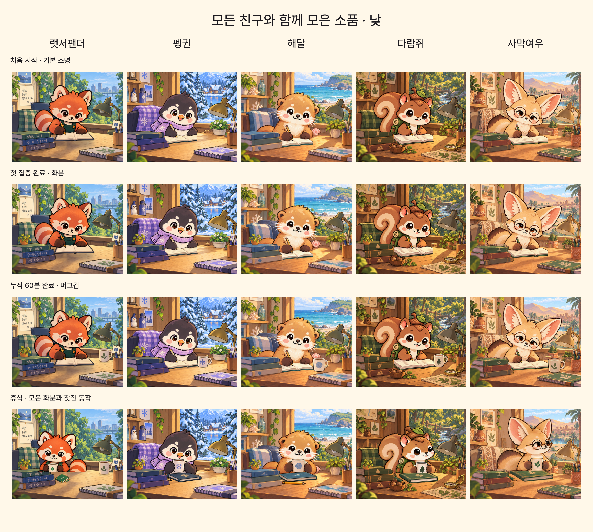
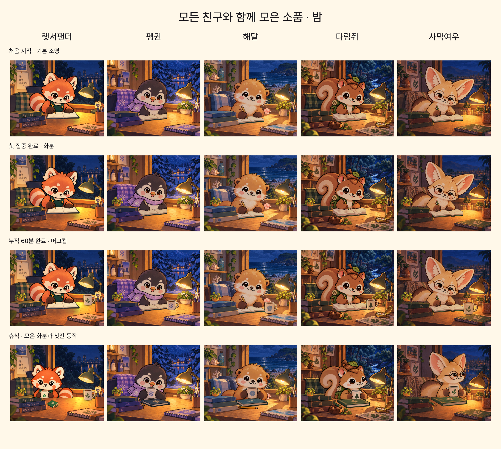

# 모든 캐릭터의 모은 소품

2026-11-06. 다섯 캐릭터가 기존의 공통 소품 해금 상태를 방과 컬렉션 미리보기에 반영합니다.

- 조명은 기본 제공, 화분은 첫 정상 집중 완료, 머그컵은 정상 완료 누적 60분입니다. 보상 조건과 저장 형식은 그대로 유지합니다.
- 네 추가 캐릭터의 방에 이미 그려진 조명은 기본 소품으로 사용합니다. 획득한 화분은 각 방의 왼쪽 책 위에 배치합니다. 창가의 기존 식물은 배경 장식입니다.
- 머그컵은 각 캐릭터의 기존 문양을 유지합니다. 획득 전에는 집중 그림의 컵 윤곽만 제외하고 뒤의 빈 책상을 드러냅니다. 획득 후에는 원래 컵을 표시하므로 중복 컵이 생기지 않습니다.
- 휴식 중 손에 든 찻잔은 랫서팬더와 마찬가지로 휴식 동작에 속하며, 머그컵 해금과 무관하게 유지합니다.
- 이미지 로딩 중에는 빈 방을 표시해 잠긴 머그컵이 잠깐 나타나지 않습니다. 해금 상태 갱신은 진행 중인 애니메이션을 초기화하지 않습니다.
- 설정의 모은 소품 미리보기는 현재 선택한 캐릭터의 방을 보여줍니다.

## 검증

- `flutter analyze --no-pub`: 문제 없음.
- `flutter test --no-pub`: 222개 통과.
- 새 테스트 9개: 네 친구의 즉시 해금 반영, 모션 유지, 집중 머그의 실제 픽셀 변화, 휴식 컵의 동일한 픽셀, 캐릭터 전환/복원 후 공유 기록 유지, 컬렉션 탐색 중 저장 상태 보존.
- `flutter test --no-pub tool/capture_collected_friends_test.dart`: 실제 위젯으로 다섯 친구의 시작/화분/머그/휴식 상태를 낮·밤에 캡처. 아래 이미지는 생성 시안이 아닌 Flutter 렌더링입니다.

