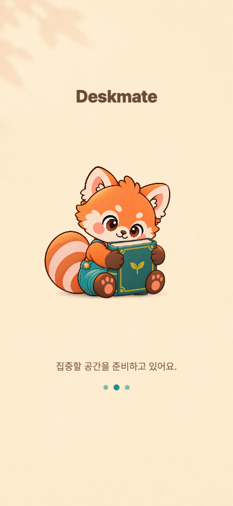

# 책을 꼬옥 안는 로딩 모션

후속 요청으로 [더 자연스럽게 연결한 v2](../startup-book-hug-v2/README.md)를 적용했습니다. 아래는 최초 책 안기 구현 기록입니다.

2026-11-06. 사용자가 선택한 [1번 시안](../startup-motion-concepts-v2/book-hug.png)을 기존 Flutter 시작 화면에 적용했습니다.



책과 양팔을 가슴 쪽으로 당기고, 눈을 감은 뒤 고개를 살짝 끄덕입니다. 원래 자세로 돌아와 잠깐 쉬는 4.5초 반복 동작입니다. 책·팔은 한 레이어로 움직여 표지와 금색 테두리가 휘지 않으며, 발·꼬리·바닥 그림자는 제자리에 유지됩니다.

동작 줄이기와 로딩 실패 상태에서는 눈을 뜬 정지 자세를 표시합니다. 백그라운드에서는 멈추고 복귀 시 이어집니다. 앱 준비가 끝나면 즉시 홈으로 넘어가며, 애니메이션을 보여주기 위한 지연은 없습니다. Android 시스템 스플래시는 정적 이미지이고 Flutter 시작 화면부터 이 동작을 재생합니다.

[9초 MP4](startup-book-hug.mp4) · [선택 시안과 포즈 비교](pose-comparison.png) · [실제 화면 3단계](motion-contact.png) · [검증 기록](design-qa.md)

## 자산과 구현

기존 캐릭터를 참조해 built-in Image Gen으로 아래 자산을 생성·분리했습니다. 모두 1254×1254 투명 PNG이며, 생성 및 수정 프롬프트를 함께 저장했습니다.

| 용도 | 이미지 | 전체 프롬프트 |
| --- | --- | --- |
| 몸통·머리·꼬리·그림자 | [hug-body-base.png](../../../assets/images/startup/hug-body-base.png) | [프롬프트](../../../assets/images/startup/hug-body-base.prompt.txt) |
| 책·양팔·손 | [hug-book-arms.png](../../../assets/images/startup/hug-book-arms.png) | [프롬프트](../../../assets/images/startup/hug-book-arms.prompt.txt) |
| 전경의 발 | [hug-feet.png](../../../assets/images/startup/hug-feet.png) | [프롬프트](../../../assets/images/startup/hug-feet.prompt.txt) |
| 끄덕일 때 감은 눈 | [reading-companion-nod.png](../../../assets/images/startup/reading-companion-nod.png) | [프롬프트](../../../assets/images/startup/reading-companion-nod.prompt.txt) |

[StartupCompanion](../../../lib/startup_companion.dart)은 30fps로 갱신하며 머리의 연속 변형, 책·팔의 이동, 발의 전경 합성을 분리합니다. 표정은 눈 주변에만 적용합니다. 모션 자산을 읽지 못하면 기본 그림을 표시합니다.

## 검증과 재현

관련 테스트와 캡처 **48개**, `flutter analyze --no-pub`, 검증용 Android debug APK 빌드를 통과했습니다. 기기 설치 및 실기기 성능 측정은 수행하지 않았습니다.

```sh
flutter test --no-pub --dart-define=STARTUP_CAPTURE_DIR=docs/design/startup-book-hug-v1/states test/startup_companion_test.dart test/startup_screen_test.dart test/update_news_flow_test.dart test/widget_test.dart tool/capture_startup_motion_test.dart tool/capture_startup_test.dart
flutter analyze --no-pub
flutter build apk --debug --no-pub --dart-define=FOCUS_FRIEND_VERIFICATION=true
```

연속 캡처는 실제 `FocusFriendApp`에 대기 중인 메모리 저장소를 주입해 390×844dp에서 실행합니다. 25fps PNG 225개를 `/private/tmp/deskmate-startup-book-hug-v1-frames`에 저장하며, 미리보기는 이 프레임으로 만든 9초 영상입니다. 책 안기 두 번과 로딩 점 다섯 주기가 맞물려 반복됩니다.
