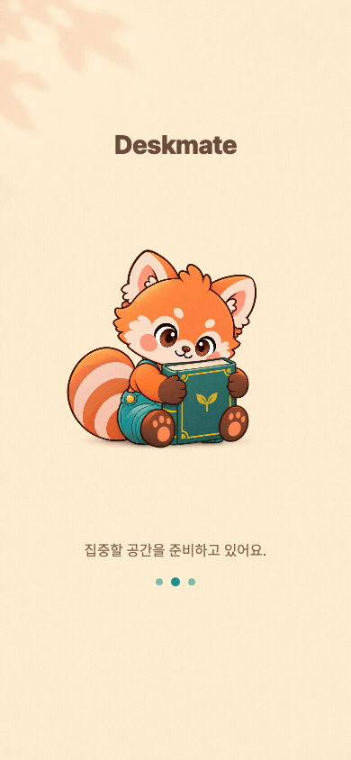

# 자연스럽게 이어지는 책 안기 모션

2026-11-06. ‘조금 더 자연스러운 모션’ 요청에 맞춰 기존 책 안기 동작을 다듬었습니다.



- 머리가 세로로 눌리는 변형을 작은 회전으로 바꿨습니다.
- 어깨는 제자리에 두고 팔꿈치와 손이 책을 따라오도록 했습니다. 책의 크기와 모양도 유지합니다.
- 안고 있는 동안 감은 눈 표정을 유지해 중간의 갑작스러운 표정 교체를 없앴습니다.
- 책을 당기는 도중에 고개가 따라오고, 조금 가라앉은 뒤 천천히 풀어지는 5.4초 동작으로 연결했습니다. 화면 갱신 목표는 60fps입니다.

[수정 전후 영상 — 왼쪽 이전 / 오른쪽 수정](before-after.mp4) · [포즈 비교](before-after-poses.png) · [새 MP4](startup-book-hug.mp4) · [검증 기록](design-qa.md)

실제 Flutter 화면을 390×844px, 50fps로 캡처한 10.8초 미리보기입니다. 새 자산 없이 기존 PNG 레이어를 재사용했습니다. 동작 줄이기·오류 정지, 백그라운드 정지·재개, 로딩 완료 즉시 홈 진입을 유지합니다. Android 시스템 스플래시는 정지 이미지입니다.

관련 테스트·캡처 **49개**, 정적 분석, Android debug APK 빌드를 통과했습니다. 후속 적용 요청으로 에뮬레이터의 일반 Deskmate 앱도 업데이트하고, 정상 실행과 기존 집중 기록 보존을 확인했습니다. 실제 휴대폰 설치와 실기기 성능 측정은 수행하지 않았습니다. [설치 검증](verification/install.md), [구현 코드](../../../lib/startup_companion.dart), [수정 전 코드](before/startup_companion.dart.txt).

## 재현

```sh
flutter test --no-pub test/startup_companion_test.dart test/startup_screen_test.dart tool/capture_startup_motion_test.dart
flutter test --no-pub --dart-define=STARTUP_CAPTURE_DIR=docs/design/startup-book-hug-v2/states test/update_news_flow_test.dart test/widget_test.dart tool/capture_startup_test.dart
flutter analyze --no-pub
flutter build apk --debug --no-pub --dart-define=FOCUS_FRIEND_VERIFICATION=true
```

연속 프레임은 `/private/tmp/deskmate-startup-book-hug-v2-frames`에 생성됩니다.
