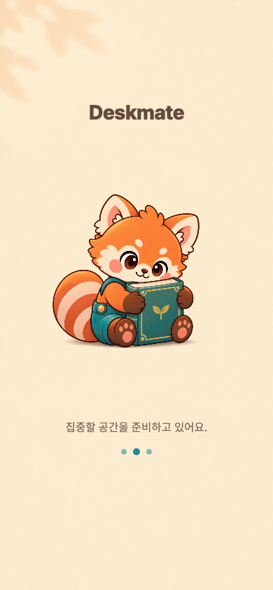

# 시작 화면 캐릭터 모션

이 문서는 초기 호흡·눈 깜빡임 구현 기록입니다. 현재는 사용자가 선택한 [책을 꼬옥 안기 모션](../startup-book-hug-v1/README.md)을 적용했습니다.

2026-11-06. 사용자가 선택한 [책을 안은 레서판다 시안](../startup-screen-concepts-v1/03-reading-companion.png)에 잔잔한 호흡과 눈 깜빡임을 추가했습니다.

- 머리와 윗몸이 3.2초마다 천천히 숨을 쉽니다. 390dp 화면에서 머리의 최대 이동은 약 2dp이며, 책·발·바닥 그림자는 고정됩니다.
- 6.4초 동안 두 번 눈을 깜빡입니다. 눈을 뜬 표정 → 반쯤 감은 표정 → 감은 표정을 눈 주변에만 적용합니다.
- 동작 줄이기 설정과 로딩 실패 상태에서는 눈을 뜬 정지 표정을 표시합니다. 백그라운드와 비활성 화면에서는 멈추고 복귀하면 이어집니다.
- Android의 시스템 시작 화면은 정지 이미지입니다. 이 모션은 Flutter 로딩 화면에서 재생되며, 준비가 끝나면 즉시 홈으로 넘어갑니다. 모션을 보여주기 위한 지연은 없습니다.

[MP4 미리보기](startup-motion.mp4) · [표정 비교](motion-contact.png) · [검증 기록](design-qa.md)

## 구현과 자산

- [위젯·렌더러](../../../lib/startup_companion.dart), [시작 화면 연결](../../../lib/startup_screen.dart)
- [기본 표정](../../../assets/images/startup/reading-companion.png)
- [반쯤 감은 눈](../../../assets/images/startup/reading-companion-half-blink.png), [생성 프롬프트](../../../assets/images/startup/reading-companion-half-blink.prompt.txt)
- [감은 눈](../../../assets/images/startup/reading-companion-blink.png), [생성 프롬프트](../../../assets/images/startup/reading-companion-blink.prompt.txt)

추가 표정은 built-in Image Gen으로 기본 그림을 참조해 생성했습니다. 작은 생성 차이가 캐릭터 전체에 나타나지 않도록 눈 주변만 사용합니다. 세 이미지는 800px로 디코딩하며, 렌더러는 최대 30fps로 갱신합니다.

## 재현

`flutter test --no-pub tool/capture_startup_motion_test.dart`로 실제 앱에 대기 중인 메모리 저장소를 주입해 390×844 화면을 캡처합니다. 25fps 연속 PNG 160개가 `/private/tmp/deskmate-startup-motion-v1-frames`에 생성됩니다. 미리보기는 그 프레임으로 인코딩한 6.4초 영상이며, 정지 이미지를 별도로 움직인 합성이 아닙니다.

Android 검증용 debug APK 빌드까지 완료했습니다. 기기 설치·실기기 성능 측정은 이번 검증에 포함하지 않았습니다.
