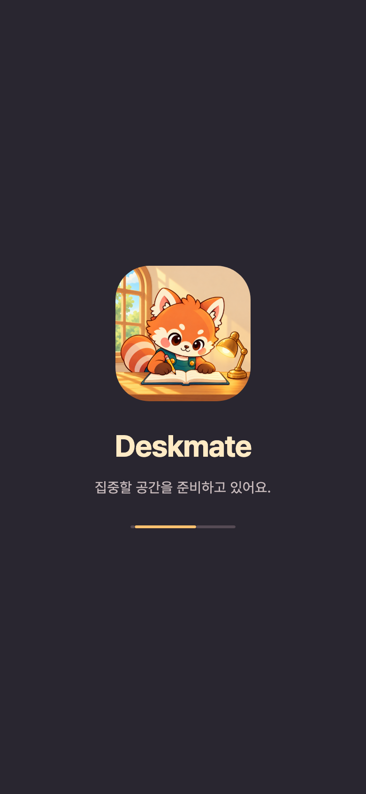
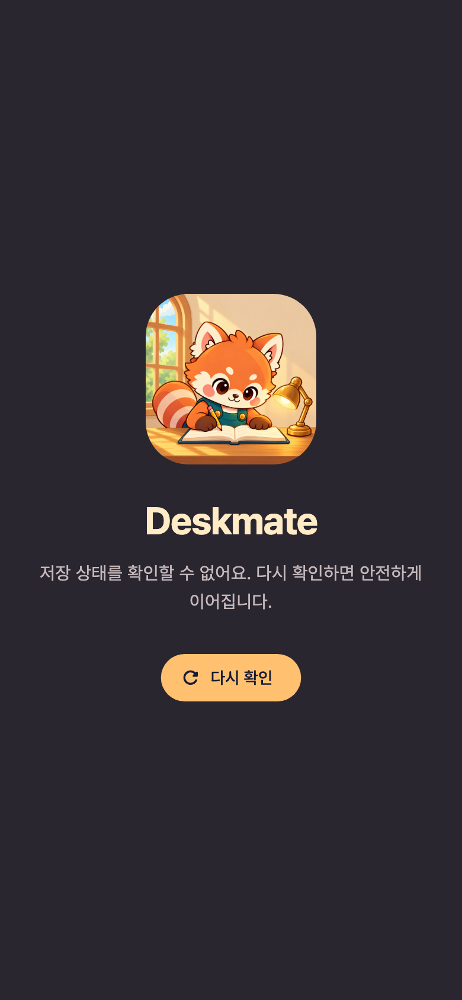

# 앱 시작 로딩 화면

2026-11-06. 실제 앱 위젯에 반영한 화면입니다.

## 동작

- Android 실행 직후부터 앱과 같은 배경색(`#292630`)과 기존 앱 아이콘을 표시합니다. Android 12 이상은 시스템 SplashScreen 속성을 사용합니다.
- Flutter에서는 앱 아이콘, Deskmate 이름, 현지화된 준비 안내와 로딩 막대를 표시합니다.
- 저장된 방과 언어를 읽을 때까지 홈과 메뉴를 표시하지 않습니다. 준비가 끝나면 즉시 홈으로 넘어가며 최소 표시 시간을 강제하지 않습니다.
- 저장소 오류는 같은 화면에서 다시 시도할 수 있습니다. 언어 읽기 오류는 기기 언어로 진행합니다.
- 앱을 백그라운드에서 다시 열 때는 기존 방을 유지하며 상태를 갱신합니다.
- 큰 글자와 가로 화면에서는 스크롤할 수 있고, 동작 줄이기 설정에서는 정적인 모래시계를 표시합니다.
- 시작 화면은 로컬 상태와 언어 복원을 기다립니다. 광고·구매 응답이나 방 이미지의 디코딩 완료를 기다리는 조건은 추가하지 않았습니다.

## 검증

- `flutter analyze --no-pub`: 통과.
- `flutter test --no-pub test/startup_screen_test.dart test/update_news_flow_test.dart test/widget_test.dart`: 37개 통과.
- `flutter build apk --debug --no-pub --dart-define=FOCUS_FRIEND_VERIFICATION=true`: 통과.
- 캡처: `flutter test --no-pub tool/capture_startup_test.dart`. 메모리 저장소 응답을 지연하거나 실패시킨 실제 앱 위젯을 캡처합니다.
- 검증용 APK 빌드까지 확인했으며 연결된 기기에는 설치하지 않았습니다.

Android 시작 화면 구성 참고: [Flutter 공식 문서](https://docs.flutter.dev/platform-integration/android/splash-screen).
