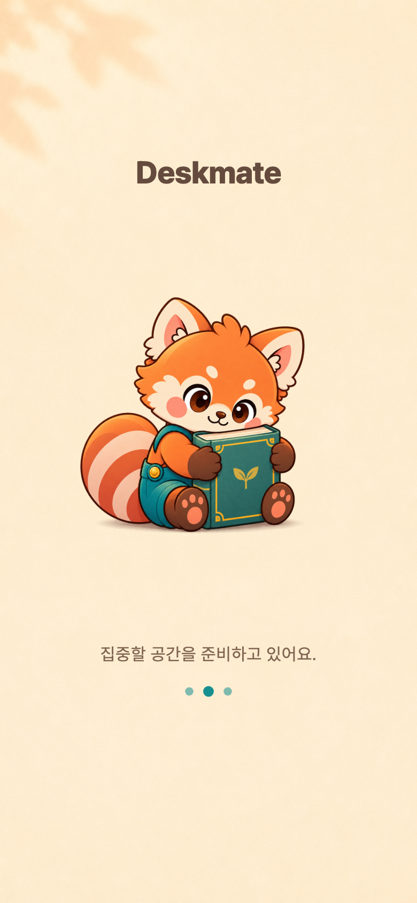

# 책을 안은 레서판다 시작 화면

2026-11-06. 사용자가 선택한 [세 번째 이미지 시안](../startup-screen-concepts-v1/03-reading-companion.png)을 실제 Flutter 시작 화면에 적용했습니다.

밝은 종이 질감 배경, 책을 안은 캐릭터, 갈색 Deskmate 제목과 현지화 문구, 천천히 밝아지는 청록색 점 세 개로 구성합니다. 글자는 실제 UI이며 저장 상태를 불러오면 바로 홈으로 넘어갑니다. 읽기 실패 시 다시 확인 버튼을 표시합니다.

현재는 사용자가 선택한 [책을 꼬옥 안기 모션](../startup-book-hug-v2/README.md)을 적용했습니다. [초기 호흡·눈 깜빡임](../startup-motion-v1/README.md)과 아래 정적 캡처는 이전 구현 기록입니다.

- [동일 크기 시안 비교](comparison.png): 왼쪽 원본, 오른쪽 실제 앱.
- [오류·재시도](retry.png)
- [작은 화면·큰 글자](compact-large-text.png)
- [가로 화면](landscape.png)
- [스페인어](spanish.png)
- [시각 검증 기록](design-qa.md)

두 이미지 자산은 built-in Image Gen을 사용해 선택 원본을 참조하여 분리 생성했습니다.

- [캐릭터](../../../assets/images/startup/reading-companion.png), [프롬프트](../../../assets/images/startup/reading-companion.prompt.txt)
- [종이 배경](../../../assets/images/startup/paper-background.png), [프롬프트](../../../assets/images/startup/paper-background.prompt.txt)

캡처 재생성: `flutter test --no-pub tool/capture_startup_test.dart`. 대기 중인 메모리 저장소를 주입한 실제 앱 화면입니다. 이번 작업은 APK 빌드까지 검증했으며 연결된 기기에는 설치하지 않았습니다.
