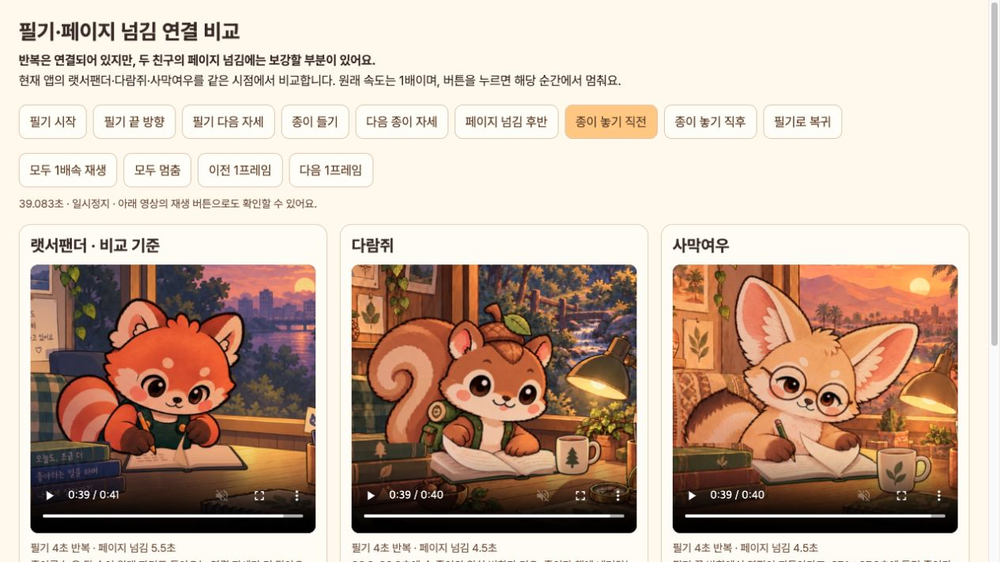

# 다람쥐·사막여우 집중 모션 연결 검토

2026-10-19. 앱 소스 `94bf927`, 현재 V10 갤러리를 랫서팬더와 비교했습니다. **연속 재생 구조는 연결되지만, 두 친구의 중간 동작을 랫서팬더와 같은 수준으로 자연스럽다고 판단하기는 어렵습니다.** 이번에는 검토와 비교 도구만 추가했고 앱 코드·원화·속도를 바꾸지 않았습니다.

[구간별 비교 화면 열기](index.html). 필기 끝 방향, 종이 들기 전후, 내려놓기 전후, 복귀 버튼으로 세 친구를 나란히 멈춰 볼 수 있습니다. 재생은 1배속이며 이전·다음 1프레임도 지원합니다.

## 단계별 결과

| 단계 | 상태 | 관찰과 근거 |
| --- | --- | --- |
| 1. 필기 왕복과 반복 | 다람쥐 대체로 연결 / 사막여우 보강 필요 | 두 친구 모두 랫서팬더와 같은 4초 왕복·12fps 시간 격자입니다. 사막여우의 4→5번 자세(1.583→1.917초)에서 연필 끝이 원래 진행 방향을 거슬러 돌아가며, 이어 5→4로 다시 반대 이동해 왕복 끝의 리듬이 흔들립니다. [전](02-writing-before.png), [후](03-writing-after.png), [사막여우 연속 자세](fennec-writing.jpg). |
| 2. 종이 들기·넘기기·내려놓기 | 두 친구 모두 보강 필요 | 사막여우 11→12번(37.083→37.333초)에서 들던 종이가 다시 낮아집니다. 다람쥐 16→19번(38.333–39.083초)에서는 손·종이의 큰 위치 변화가 연속으로 나타납니다. 19→20번(39.083→39.333초)에서 다람쥐는 들린 종이가 갑자기 평평해지고 사막여우는 종이 높이가 크게 낮아져, 내려앉는 동작이 짧습니다. [들기 전](04-lift-before.png), [들기 후](05-lift-after.png), [내려놓기 전](06-settle-before.png), [내려놓기 후](07-settle-after.png). |
| 3. 필기로 복귀·전체 주기 경계 | 구조상 연결됨 | 22번은 필기 1번을 복귀 연결로 재사용하고, 23번은 기본 0번입니다. 끝에서 시작으로 순간 이동하는 주기 구조는 아닙니다. 이 사실은 2단계의 원화 사이 거리나 손·종이 경로가 자연스럽다는 보장은 아닙니다. [복귀 화면](08-return.png), [복귀·반복 경계 연속 자세](fennec-boundaries.jpg). |

## 랫서팬더와의 차이

| 항목 | 랫서팬더 | 다람쥐·사막여우 |
| --- | --- | --- |
| 필기 리듬 | 6개 자세를 4초 동안 왕복 | 같은 재생 배열, 서로 다른 원화 |
| 필기 구간 | 36초 | 36초 |
| 넘김·복귀 구간 | 5.5초 | 4.5초 |
| 넘김·복귀에 사용되는 자세 | 기본 자세 포함 26개(동작 25개) | 기본 자세 포함 18개(동작 17개) |
| 주기 시작·끝 | 기본 자세로 연결 | 기본 자세로 연결 |

숫자 자체가 품질을 보장하지는 않습니다. 랫서팬더는 손을 뻗고 종이를 놓은 뒤 팔을 되돌리는 연결 자세가 더 촘촘합니다. 두 친구는 기존 공통 시계의 각 자세를 3틱(0.25초)씩 유지하므로 자세 사이의 큰 위치 변화가 그대로 드러납니다. 속도만 낮추기보다 원화 경로를 먼저 맞춰야 합니다.

[랫서팬더 페이지 연속 자세](redpanda-page.jpg) · [다람쥐 페이지 연속 자세](squirrel-page.jpg) · [사막여우 페이지 연속 자세](fennec-page.jpg) · [내려놓기 비교](page-settle-comparison.jpg)

## 권장 수정 순서

1. 사막여우 필기 3–5번의 연필 끝 경로와 손 모양을 정리해 왕복 끝에서의 불필요한 되돌림을 줄입니다.
2. 종이를 잡는 손, 종이 윗모서리, 책의 가운데 접힘을 기준으로 들기 → 반대편으로 넘기기 → 내려놓기의 방향을 맞춥니다. 사막여우 11→12번의 하강과 두 친구의 후반 전환을 우선 수정합니다.
3. 종이가 낮아지고 책에 닿는 자세, 손이 종이를 놓고 원래 자리로 돌아오는 자세를 추가한 뒤 각 거리와 동작에 맞춰 노출 시간을 조정합니다.
4. 수정 후 같은 화면에서 1배속 전체 주기와 전환 구간을 다시 비교합니다. 단순한 이미지 혼합이나 전체 몸 이동으로 간격을 메우지 않습니다.

## 검토 근거·한계

- 현재 브라우저에서 집중 상태를 열고 실제 재생되는 V10 앱 캡처 3개를 1배속과 단계별 정지 상태로 확인했습니다. 이번에 저장한 스크린샷을 열어 내용이 맞는지 확인했습니다. [초기 갤러리](01-focus-gallery.png), [브라우저 검증](browser-verification.json).
- [extract_motion.py](extract_motion.py)는 해당 갤러리가 제공하는 MP4를 새로 디코딩하여 각 자세·경계의 비교 이미지를 추출합니다. 소스는 이전에 제작한 실제 Flutter 위젯 캡처 영상이며, 이번에 새 Android GPU 녹화를 한 것은 아닙니다. 이미지의 내용·색·위치를 보정하거나 중간 동작을 합성하지 않았습니다.
- [프레임 검사 JSON](frame-inspection.json)의 RGB 차이는 살펴볼 전환을 찾는 보조 수치입니다. 캐릭터별 크기와 종이 면적이 달라 수치만으로 자연스러움의 통과 기준을 정하지 않았습니다.
- `flutter test test/friend_motion_test.dart test/reference_companion_test.dart --reporter expanded`: **17개 통과**. [로그](motion-tests.log). 고정 영역·재생 시계·일시정지 등은 검사하지만, 연필과 종이의 미술적 경로를 자동 판정하지는 않습니다.
- 앱의 동작 줄이기와 일시정지 로직은 유지되고 관련 테스트도 통과했습니다. 전체 접근성 적합성이나 기기별 프레임 드롭은 이번 범위에 포함하지 않았습니다.
- 재생 구현: [공통 필기·페이지 시계](../../../lib/friend_motion_clock.dart), [랫서팬더 시계](../../../lib/reference_study_animation.dart), [새 원화 패키징](../../../tool/package_window_study.py).

