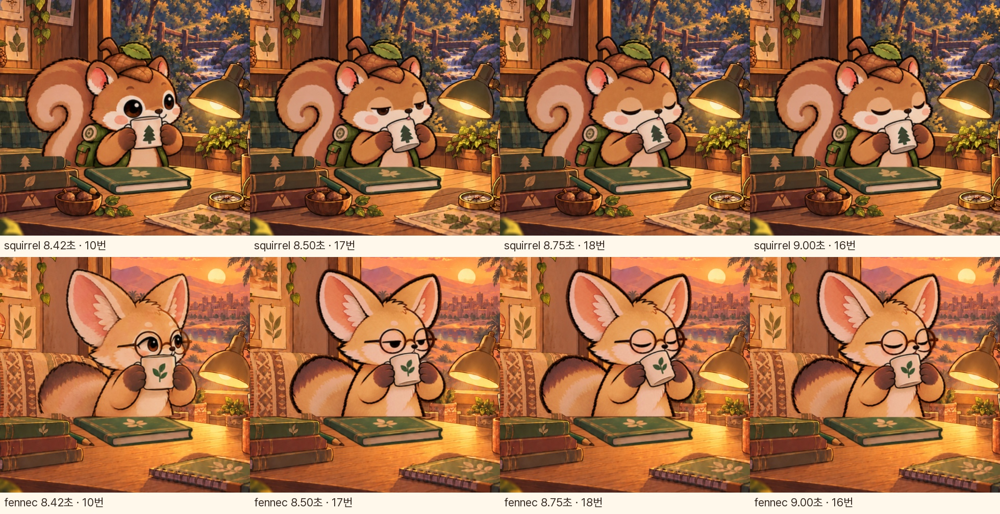

# 다람쥐·사막여우 전신 흔들림: 문제 확인

**사용자가 지적한 전신 흔들림이 있습니다.** 팔과 컵뿐 아니라 얼굴 아래선, 어깨, 몸통 폭, 꼬리 형태와 위치도 원화 사이에서 달라져, 마시는 자세로 들어가고 돌아올 때 캐릭터 전체가 흔들려 보입니다.

앞선 점검에서 이를 작은 윤곽 차이로만 설명한 것은 문제의 범위를 충분히 전달하지 못했습니다. 입 접촉·타이머·책 고정 검사가 통과해도 전신의 일관성이 확보됐다는 뜻은 아닙니다.

[원래 속도로 해당 구간 확인](http://127.0.0.1:8127/docs/design/tea-body-stability-audit-v6/) · [7.5~12.5초 두 캐릭터 나란히 보기](mouth-body-1x.mp4)

## 확인한 구간

| 단계 | 현재 한 주기에서 시간 | 판정 |
| --- | --- | --- |
| 1. 마시는 자세로 진입 | 8.5~9초 | 문제 있음. 10→17→18→16번 원화에서 어깨·몸통·꼬리와 얼굴 윤곽도 함께 달라짐. |
| 2. 한 모금 유지 | 9~10.5초 | 고정 정상. 같은 16번 그림을 유지하며, 이 구간의 새 캡처 프레임이 픽셀 단위로 동일함. |
| 3. 원래 자세로 복귀 | 10.5~11초 | 문제 있음. 16→18→17→10번으로 돌아오며 같은 형태 변화가 다시 발생함. |

정확한 시간과 원화 번호는 [새 캡처 검사](body-transition-check.json)에 기록했습니다. 단순한 전체 이미지 차이 영역은 흔들림의 크기나 방향을 측정한 값으로 해석하지 않았습니다. 실제 인접 원화와 앱 화면을 함께 확인했습니다.

## 원인

현재 렌더러는 일정한 영역에 연결된 캐릭터 그림 한 장을 표시합니다. 시간에 따라 캐릭터 전체를 회전·확대·이동시키는 흔들기 효과는 없습니다. 하지만 새 마시는 원화 자체의 몸 형태가 직전 그림과 다릅니다. 각 원화를 위치 등록해도, 서로 다른 어깨·몸통·꼬리의 형태를 하나의 이동이나 배율로 동시에 맞출 수 없습니다.

중간 작화 등록도 머리의 일부 특징을 기준으로 했기 때문에 몸 전체의 일치를 보장하지 못했습니다. 따라서 속도를 늦추거나 재생 그림 수만 늘리는 것으로 해결되지 않습니다.

## 필요한 보완

한 기준 자세의 머리·몸통·꼬리 크기, 위치와 외곽을 유지하고, 눈꺼풀·팔·손·컵이 바뀌는 연결 원화를 다시 맞춰야 합니다. 팔·손은 몸에 붙은 상태로 그립니다. 마시기 전→입 접촉→기울이기→복귀 순서에서 움직이지 않아야 할 부위가 함께 바뀌는지 먼저 검사해야 합니다.

이 문서는 **문제 확인 결과**이며, 수정 완료 보고가 아닙니다. 이번에는 앱 원화와 재생 코드를 변경하지 않았습니다.

## 근거와 범위

- 이번 점검에서 현재 `FocusFriendApp`의 실행 중인 휴식 화면을 각 캐릭터 두 주기 새로 캡처했습니다. 기존 영상은 근거로 재사용하지 않았습니다.
- 실제 앱 위젯과 현재 자산을 사용했으며, 사용자 기록을 바꾸지 않도록 메모리의 휴식 세션으로 캡처했습니다. 실기기 화면 녹화는 아닙니다.
- 캡처 검사 통과는 캡처 성공을 뜻합니다. 전신 흔들림이 없다는 판정으로 사용하지 않았습니다.
- [캡처 로그](capture.log), [전체 자세·시간 기록](capture/capture-manifest.json), [현재 앱 인접 자세](mouth-transition-app-contact.jpg), [현재 런타임 원화](runtime-mouth-poses.jpg)를 보관했습니다.
- 동작 줄이기 등의 접근성 기능 전체를 이번에 다시 검증한 것은 아닙니다. 정지 화면만으로 접근성 준수나 실기기 성능을 보증하지 않습니다.

## 이번에 확인한 화면

### 1. 진입 전 기준 자세

### 2. 마시는 자세

### 3. 복귀 중

### 인접 네 원화의 실제 앱 표시

