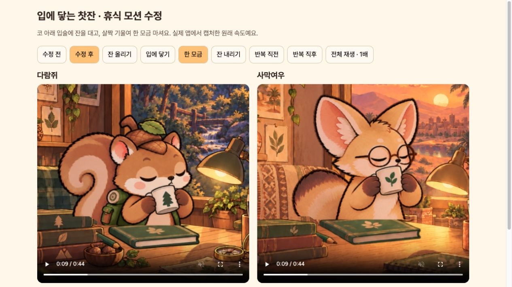
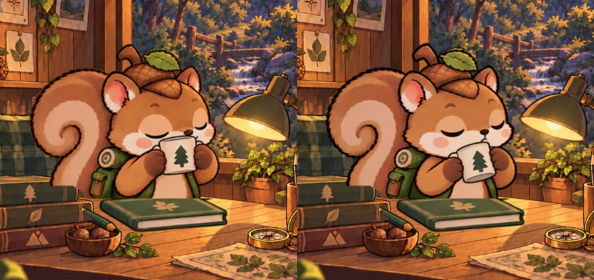
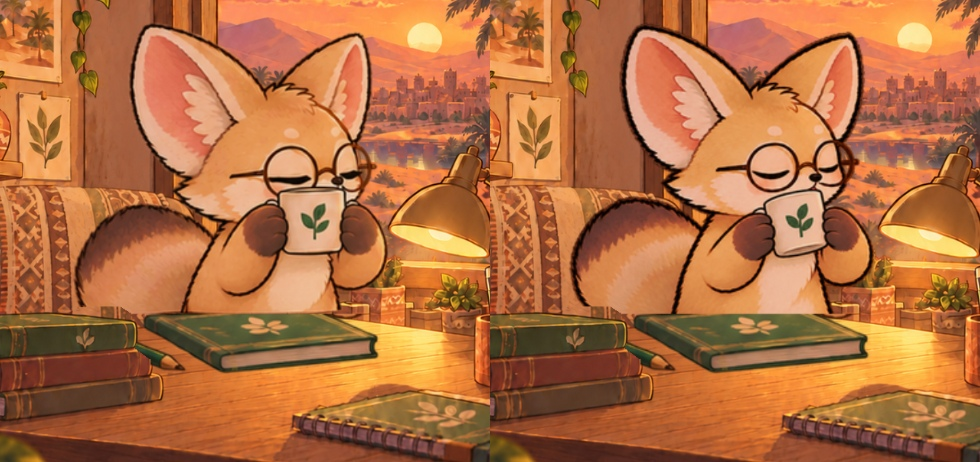

# 찻잔이 입에 닿도록 휴식 모션 수정

다람쥐·사막여우의 찻잔이 코 높이까지 올라가던 자세를 제외하고, **코 아래 입술에 잔을 댄 뒤 살짝 기울여 마시는 새 연결 원화**로 교체했습니다.

[움직이는 전후 비교](http://127.0.0.1:8127/docs/design/window-tea-mouth-v4/)에서 수정 전/후, 입에 닿기, 한 모금, 내리기와 반복 경계를 비교할 수 있습니다. 영상은 실제 `FocusFriendApp`을 새로 캡처한 1배 속도입니다. 수정 후 각 캐릭터 두 주기(44초)를 기록했습니다.

## 달라진 동작

- 잔을 올리는 동안 코를 향해 계속 상승하던 기존 11~15번 원화는 사용하지 않습니다.
- 새 입술 접촉 원화와 기울이기 원화를 추가했습니다. 손·팔·어깨·몸은 한 장의 연결된 그림입니다.
- 중간 작화 후보는 등록된 컵 위치를 측정해서 골랐습니다. 상승 중 높이가 되돌아가거나 옆으로 과하게 튀는 후보는 재생에서 제외했습니다.
- 올리기 3.5초 전체에 한 번의 완만한 가속·감속을 적용했습니다. 그림마다 다시 출발/정지하지 않습니다. 내리기는 동일한 경로의 역순입니다.
- 한 주기 22초, 기울이기 0.5초, 한 모금 1.5초, 내리기 전 되돌리기 0.5초입니다. 대기 중 눈을 깜빡입니다.
- 책·연필·배경은 고정입니다. 캐릭터 그림을 혼합하거나 몸을 흔드는 변형은 없습니다.

다람쥐는 실제 17개, 사막여우는 18개의 서로 다른 원화를 재생합니다. 12fps는 재생 시간의 격자이며 초당 새 그림 12장이 있다는 뜻은 아닙니다. 작은 원화 윤곽/얼굴 형태 차이와 일부 자세 간격은 남아 있습니다. 이번 수정은 입에 닿는 동작과 이동 경로를 개선한 것이며, 모든 프레임의 윤곽이 완전히 동일하다는 판정은 아닙니다.

## 검증

- 전체 Flutter 테스트 98개 통과, 휴식 모션 집중 검사 7개 통과.
- 실제 앱 수정 후 2주기 캡처 테스트 통과. 수정 전도 이번 작업에서 새로 캡처했습니다.
- 정적 분석 이상 없음, Android 디버그 APK 빌드 성공.
- 입에 닿는 순간, 한 모금, 올리기·내리기, 시작·반복 경계를 실제 앱 캡처와 브라우저에서 확인했습니다.
- 모든 원화에서 책 영역의 실제 픽셀이 고정되는지 검사했습니다.
- 일시정지/재개, 앱 백그라운드/복귀, 화면 비활성화, 동작 줄이기 검사를 통과했습니다.
- 21.916초와 22.000초의 실제 전체 앱 화면이 픽셀 단위로 같습니다. [반복 경계 기록](loop-boundary-check.json)
- 에뮬레이터 `emulator-5554`의 기존 앱을 업데이트하며 저장 JSON 일치와 APK 내부 이미지 일치를 확인했습니다. [저장 데이터 검사](data-preservation.json)

[전체 테스트](tests.log) · [집중 검사](targeted-tests.log) · [분석](analyze.log) · [빌드](build.log) · [캡처 기록](after/capture.log) · [실제 시각 시계](after/capture-manifest.json)

## 이미지 제작 기록

**built-in ImageGen**으로 새 자세와 중간 그림을 제작했습니다. [프롬프트·원본·채택 기록](asset-manifest.json)에 사용 경로를 기록했습니다. 기존 이미지 원본은 보존했습니다. 잘못 올라가던 첫 기울이기 후보도 `art/*-tilt-rejected-raw.png`에 남기고 재생에는 사용하지 않았습니다.

기계적 포장은 `tool/package_mouth_tea.py`입니다. 그림 전체에 동일 비율 확대/축소 및 위치 등록, 떨어진 투명 가장자리 조각 정리, 고정 소품 영역 합성, 아틀라스 배치만 수행합니다. 팔·손·컵을 별도로 회전시키거나 늘려서 작화를 만들지 않았습니다.

최종 앱 자산:
- `assets/images/friends/motion/squirrel/rest.png`
- `assets/images/friends/motion/fennec/rest.png`

작업용 등록 원화: `art/{squirrel,fennec}-cel-*.png`, 포장본: `art/{squirrel,fennec}-rest-packed.png`, 등록 변환: `art/{squirrel,fennec}-registration.json`.

## 실제 앱에서 보이는 한 모금

### 다람쥐 수정 전 / 후

### 사막여우 수정 전 / 후

