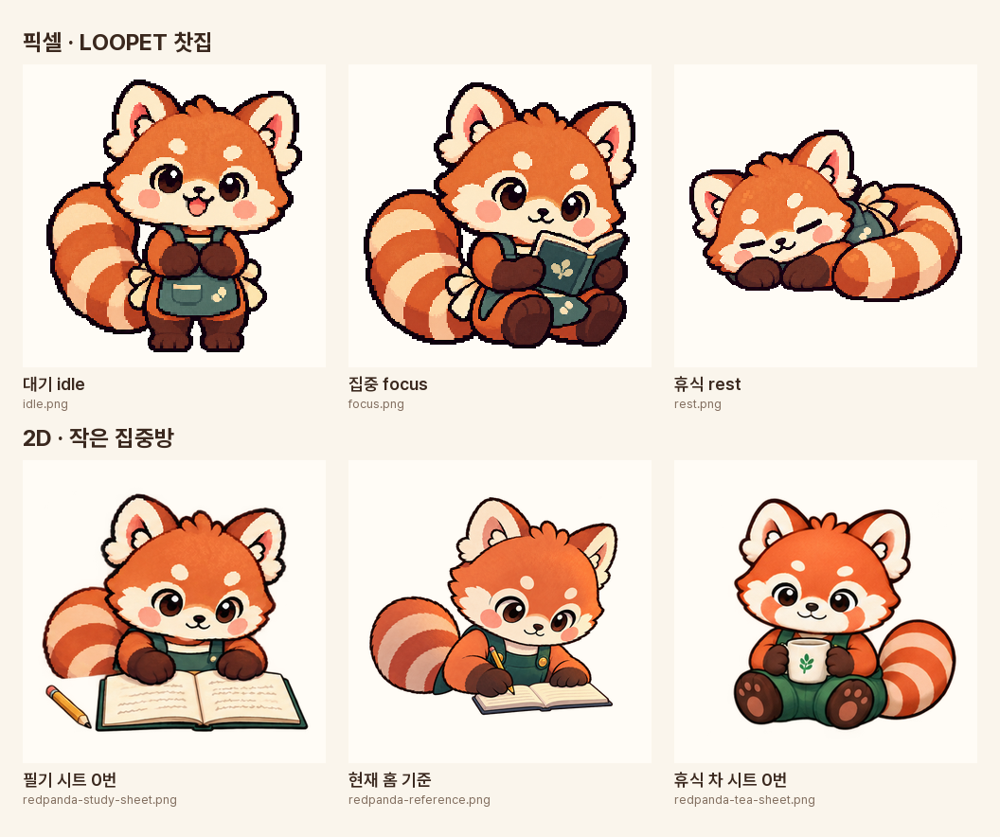

# 랫서팬더 기준표

> **초안 v0.1 · 2026-10-09** · 세 앱 공통 문서의 일부입니다([공통 규칙](../README.md)).
> 표기: **[확인]** 원본에서 확인 · **[제안]** 제안 설정 · **[미정]** 아직 정하지 않음.
> 방향은 모두 **화면 기준**입니다.

- **이름:** [미정] 앱 안에는 개인 이름 없이 "랫서팬더 찻집 팩"으로만 나옵니다 [확인: `routine_app/flutter_app/lib/l10n/app_ko.arb`].
- **등장 앱:** [확인]
  - LOOPET: 찻집 팩. 픽셀, 384×384 RGBA 포즈 여섯 장
  - 작은 집중방: 책상과 휴식 장면. 2D 동화풍
- **일상:** [제안] 낮에는 찻집, 저녁에는 책상에서 공부합니다. 성격·고민·관계는 [공통 규칙](../README.md#친구들)에 있습니다.

## 픽셀 · 2D 비교



- 위 줄은 LOOPET 픽셀 포즈(`idle`·`focus`·`rest`)입니다.
- 아래 줄은 작은 집중방 2D입니다(필기 시트 0번 칸, 현재 홈 기준 원화, 휴식 차 시트 0번 칸).
- 필기 시트는 원본 칸 경계에서 잘라서 꼬리 왼쪽 끝이 잘려 보입니다.
- 다시 만들기: `python3 docs/universe/tools/make_red_panda_compare.py`

## 두 표현에 공통인 특징 [확인]

비교판 여섯 장에서 일치하는 특징입니다. 눈은 눈을 뜬 장면 기준입니다.

- 주황빛 붉은 털과 짙은 갈색 윤곽선
- 크게 선 귀: 크림색 테두리, 분홍 안쪽, 귀 아래 크림색 털뭉치
- 크림색 주둥이와 양 볼의 크림색 털, 눈 위의 크림색 눈썹 점
- 흰 반사광이 있는 동그랗고 짙은 갈색 눈
- 분홍 볼터치
- 작고 짙은 코와 작게 웃는 입
- 짙은 갈색 팔·손
- 주황과 크림색 고리 무늬의 통통한 꼬리
- 청록 계열의 옷

## 표현별 차이 [확인]

| 항목 | LOOPET 픽셀 | 집중방 필기 시트 | 집중방 현재 홈 | 집중방 휴식 차 시트 |
|---|---|---|---|---|
| 옷 | 청록 앞치마, 크림색 허리끈 리본, 앞주머니 | 청록 가슴판과 어깨끈 (프롬프트상 앞치마) | 청록 멜빵바지, 금색 단추 | 초록 멜빵바지, 다리까지 덮음 |
| 다리 | 짙은 갈색 | 보이지 않음 | 보이지 않음 | 바지 아래 갈색 발, 분홍 발바닥 |
| 꼬리 위치 | 화면 왼쪽 (`rest`는 오른쪽) | 화면 왼쪽 | 화면 왼쪽 | 화면 오른쪽 |
| 색감 | 기준 | 픽셀과 가까움 | 약간 밝음 | 털 채도가 높고, 옷이 청록보다 초록에 가까움 |

출처:
- 픽셀 앞치마: `routine_app/flutter_app/design/red-panda-concept/README.md`의 "청록색 앞치마"
- 필기 시트: `focus_friend_app/assets/images/redpanda-study-sheet.prompt.txt`의 "teal-green apron with cream sash"
- 현재 홈: `focus_friend_app/assets/images/immersive/redpanda-reference.prompt.txt`의 "teal overalls"

## 바꾸면 안 되는 특징 [제안]

우선순위 순서입니다. AI 이미지 제작 뒤 이 순서로 대조합니다.

1. **얼굴 무늬:** 크림색 주둥이, 볼 털, 눈 위 눈썹 점의 배치
2. **눈:** 동그랗고 짙은 갈색에 흰 반사광. 선 하나로 그린 눈은 웃거나 잠잘 때만 씁니다.
3. **귀:** 크림색 테두리, 분홍 안쪽, 아래쪽 털뭉치
4. **꼬리:** 주황·크림 고리 무늬의 통통한 꼬리. 고리 개수는 고정하지 않습니다.
5. **색:** 주황빛 붉은 털 + 짙은 갈색 팔다리 + 청록 계열 옷
6. **비율:** 머리가 몸보다 큰 2등신 안팎

고정하지 않는 것 [제안]:
- **꼬리 위치:** 픽셀 `rest`와 휴식 차 시트에서 이미 오른쪽에 있어 포즈에 따라 바뀝니다. 다만 같은 동작 시트 안에서는 바꾸지 않습니다.
- **소품:** 책, 연필, 찻잔은 장면에 따라 바뀝니다.

## 의상

[미정] 현재 원본에 앞치마와 멜빵바지가 섞여 있습니다. 두 가지 안이 있습니다.

- **A안 (추천):** 옷의 **색(청록)은 고정**하고 **종류는 장면별**로 둡니다.
  - 찻집에서 일할 때: 앞치마와 크림색 허리끈
  - 집에서 공부하거나 쉴 때: 멜빵바지
  - "같은 친구의 다른 일상"과 맞고, 지금 쓰는 에셋을 그대로 쓸 수 있습니다.
  - 지금 집중방 코드가 참조하는 현재 홈 원화와 휴식 차 시트는 모두 멜빵바지입니다.
  - 한 앱 안에서는 한 가지로 맞춥니다.
- **B안:** 모든 장면을 앞치마로 통일합니다. 집중방 원화를 다시 만들어야 합니다.

A안을 고르면 남는 일이 하나 있습니다. 휴식 차 시트의 옷 색이 초록에 가깝습니다. 다음에 원화를 고칠 때 청록으로 맞출지 함께 정합니다.

## 표현 규칙

- **픽셀:** [확인]
  - LOOPET 앱 포즈는 384×384 RGBA PNG입니다(`routine_app/.../redpanda_teashop/v1/approved/README.md`).
  - 확대할 때는 최근접 보간을 씁니다. [제안]
- **2D:** [확인]
  - 짙은 윤곽선과 무광 질감의 동화풍입니다(`focus_friend_app/README.md`).
  - 픽셀 원본의 정체성을 참조해 만들었습니다(`redpanda-study-sheet.prompt.txt`의 참조 이미지에 LOOPET `focus.png`가 있음).

## AI 프롬프트용 정체성 문구 [제안]

기존 집중방 프롬프트에서 정체성 부분만 뽑았습니다. 옷 줄은 장면에 맞게 하나만 고릅니다.

```text
The SAME red panda character, not a generic bear, fox or cat.
Soft orange-red coat with dark brown outline. Large upright ears with cream rims,
pink inner ears and cream fluffy tufts at the base. Cream muzzle, cream cheek tufts,
cream eyebrow dots above the eyes. Round glossy dark brown eyes with white highlights,
pink blush cheeks, small dark nose, small smile. Dark brown arms and paws.
Plump ringed tail in orange and cream. Chibi proportions, head larger than body.
Outfit (teashop): teal-green apron with cream waist sash.
Outfit (home/study/rest): teal-green overalls.
```

## 기준 이미지 기록

확인 날짜는 2026-10-09입니다. 커밋은 그 파일을 마지막으로 바꾼 커밋입니다.

| 역할 | 저장소 · 경로 | 커밋 | SHA-256 |
|---|---|---|---|
| 정체성 원본 (픽셀 포즈 시트) | `routine_app` · `flutter_app/design/red-panda-concept/pose-sheet-v1.png` | `391e8de` 2026-10-01 | `0427b971a9ccb934a5dff944ea00298c7bc5119a50fe054730febb5be948c01e` |
| 픽셀 대기 | `routine_app` · `flutter_app/assets/characters/redpanda_teashop/v1/approved/idle.png` | `391e8de` 2026-10-01 | `dd878ec7cac94fd6e72c70266d61fad1e959bca7fdc8bff742d70a3b64ccf8ab` |
| 픽셀 집중 | `routine_app` · `flutter_app/assets/characters/redpanda_teashop/v1/approved/focus.png` | `391e8de` 2026-10-01 | `e203af03dca4042ec4e66a4e262935e3e771200ac0b2c1ae391f2d5f33c8417f` |
| 픽셀 휴식 | `routine_app` · `flutter_app/assets/characters/redpanda_teashop/v1/approved/rest.png` | `391e8de` 2026-10-01 | `69bea2da76b285bc39e3dfca2d4c79322412f8014a9d66376c079bf006269cf4` |
| 2D 스토리보드 | `focus_friend_app` · `docs/design/character-concepts/redpanda-writing-study.png` | `237650f` 2026-10-08 | `c17cd41dd256e75a8304cdd22de5712b59e1a377ef80ce452051a2065df37dd5` |
| 2D 필기 시트 | `focus_friend_app` · `assets/images/redpanda-study-sheet.png` | `237650f` 2026-10-08 | `e84725f658c3d838894daf2c5efd06f745e17c9e53ce84fb7985c61980e2c55b` |
| 2D 현재 홈 기준 | `focus_friend_app` · `assets/images/immersive/redpanda-reference.png` | **미커밋** | `36c4b09dfc1db8491286b4546ca060bbce2b405b9802a3e2e89aa7f89e208747` |
| 2D 휴식 차 시트 | `focus_friend_app` · `assets/images/rest/redpanda-tea-sheet.png` | **미커밋** | `47de2f16179569d9fa9ef8d368bc478fab32bf3ad1c4d739d763b3e337951243` |

미커밋 파일은 커밋한 뒤 커밋 칸을 채웁니다. 원본이 바뀌었는지는 `shasum -a 256 <경로>`로 SHA-256을 비교해 확인합니다.

## 미정

- 이름
- 의상 규칙 (A안 / B안)
- 휴식 차 시트의 옷 색 보정 여부
